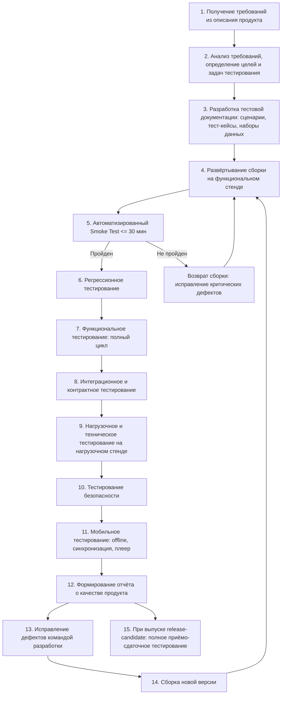
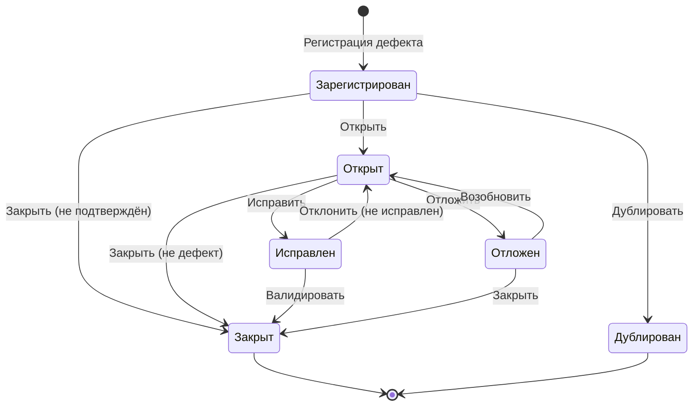

# ПЛАН ТЕСТИРОВАНИЯ

## BookSphere

Product version v 1.0.0

| | |
|---|---|
| Предоставлено для: | Заказчик |
| Предоставил: | Компания-исполнитель |
| Дата: | Октябрь 2026 г. |
| Версия: | V 1.0.0 |
| Исполнитель: | Руководитель группы тестирования |

---

## История изменений

| Версия | Дата | Автор | Комментарии |
|---|---|---|---|
| V1.0.0 | Октябрь 2026 | Руководитель группы тестирования | Первичная версия документа. Определены стратегия, объём, ресурсы и график тестирования платформы BookSphere |

---

## Содержание

1. Список сокращений и аббревиатур
2. Введение
   - 2.1 Содержание документа
   - 2.2 Цель документа
   - 2.3 Целевая аудитория
   - 2.4 Ссылки на проектную документацию
   - 2.5 Обзор программного продукта
   - 2.6 Цели тестирования
3. Объём тестирования
   - 3.1 Перечень тестируемых компонентов
   - 3.2 Нетестируемые компоненты
4. Требуемые ресурсы
   - 4.1 Проектная команда
   - 4.2 Тестовая конфигурация
5. Стратегия тестирования
   - 5.1 Функциональное тестирование
     - 5.1.1 Минимальный приемочный тест (Smoke Test)
     - 5.1.2 Регрессионное тестирование
     - 5.1.3 Функциональный тест
   - 5.2 Автоматизированное тестирование
   - 5.3 Техническое тестирование
6. Методология тестирования
   - 6.1 Обзор процесса
   - 6.2 Тестовая документация
   - 6.3 Доставка новых версий программного продукта
     - 6.3.1 Процесс доставки
     - 6.3.2 Критерии приемки на тестирование
   - 6.4 Управление дефектами
     - 6.4.1 Определение степени важности дефектов
     - 6.4.2 Определение приоритета дефектов
     - 6.4.3 Цикл жизни дефекта
     - 6.4.4 Матрица переходов
     - 6.4.5 Процесс взаимодействия команд тестирования и разработки при работе с дефект-трекинговой системой
     - 6.4.6 Регистрация дефектов
     - 6.4.7 Критерии качества продукта
     - 6.4.8 Правила наименования пользователей системы
     - 6.4.9 Правила ведения переписки
7. График тестирования
   - 7.1 Календарный план
   - 7.2 Общая оценка временных затрат
8. Оценка рисков проекта тестирования
9. Отчёты о результатах тестирования
   - 9.1 Журнал тестирования
   - 9.2 Протокол тестирования
   - 9.3 Отчёт о зарегистрированных дефектах

---

## 1. Список сокращений и аббревиатур

| Сокращение / аббревиатура | Описание |
|---|---|
| API | Application Programming Interface — программный интерфейс взаимодействия сервисов |
| CI/CD | Continuous Integration / Continuous Delivery — непрерывная интеграция и доставка |
| DRM | Digital Rights Management — защита цифрового контента от копирования |
| Контрактное тестирование | Проверка соответствия интерфейсов взаимодействия между сервисами согласованным контрактам (схема запроса/ответа) |
| МПТ | Минимальный приёмочный тест |
| МОК | Имитация внешнего сервиса, возвращающая заранее заданные ответы |
| Нагрузочное тестирование | Проверка работоспособности системы при целевой одновременной нагрузке |
| Окружение | Совокупность серверов, сервисов и конфигураций, на которых проводится тестирование |
| Платформа | Программный продукт BookSphere в полном составе микросервисов, клиентских приложений и инфраструктуры |
| Регрессионное тестирование | Повторное прохождение тестов для подтверждения отсутствия новых ошибок после изменений |
| SLA | Service Level Agreement — соглашение об уровне доступности сервиса |
| Smoke Test | МПТ |
| Спринт | Итерация разработки и тестирования длительностью 2 недели по методологии Agile/Scrum |
| Стенд | Выделенная инфраструктура для проведения определённого вида тестирования |
| VU | Virtual User — виртуальный пользователь при нагрузочном тестировании |

---

## 2. Введение

### 2.1 Содержание документа

Документ описывает процесс тестирования, стратегию и подходы к обеспечению качества e-commerce платформы BookSphere — масштабируемого решения для продажи печатных книг, электронных книг и аудиокниг, построенного по архитектуре Headless Commerce на базе микросервисов в Kubernetes.

Документ определяет порядок взаимодействия группы тестирования и команды разработки в процессе проверки приложения, включая работу с дефект-трекинговой системой, доставку сборок и формирование отчётности.

### 2.2 Цель документа

- Спланировать управление тестированием и техническую поддержку тестирования в ходе жизненного цикла разработки BookSphere.
- Обеспечить полноту тестирования в соответствии с функциональными и нефункциональными требованиями к продукту, охват всех типов тестирования, определить необходимую тестовую документацию.
- Организовать контроль процесса тестирования, определить методы регистрации дефектов, состав стендов, виды отчётности.
- Определить график работ, описать используемую методологию и стратегию тестирования.
- Установить критерии качества и критерии готовности к релизу.
- Определить ресурсы, необходимые для реализации проекта тестирования.
- Описать документацию, создаваемую для обеспечения тестирования по проекту.

### 2.3 Целевая аудитория

Документ предназначен для использования сотрудниками группы тестирования проекта и определяет цели, содержание работ и этапы тестирования платформы BookSphere.

Также документ предназначен для ознакомления команды разработки с процессами взаимодействия с группой тестирования, методами регистрации и отслеживания дефектов, составом предоставляемой тестовой документации.

### 2.4 Ссылки на проектную документацию

План тестирования основан на следующих документах:

| № | Документ | Статус |
|---|---|---|
| [1] | Описание продукта «Паспорт программного продукта BookSphere» | Утверждено |
| [2] | Сценарии тестирования BookSphere (формат: таблица в Jira / Xray) | Создаётся по настоящему плану |
| [3] | Журнал тестирования BookSphere (формат: таблица) | Создаётся по настоящему плану |
| [4] | Сценарии нагрузочного и технического тестирования | Создаётся по настоящему плану |
| [5] | Сценарии тестирования безопасности | Создаётся по настоящему плану |
| [6] | Наборы тестовых данных (каталог, пользователи, заказы) | Создаётся по настоящему плану |

### 2.5 Обзор программного продукта

BookSphere — масштабируемая e-commerce платформа нового поколения для продажи печатных книг, электронных книг (e-books) и аудиокниг. Продукт построен по архитектуре Headless Commerce, что позволяет гибко управлять контентом и адаптировать интерфейс под каналы продаж: Web, Mobile App, Smart TV, голосовые ассистенты.

Платформа реализована в виде микросервисной архитектуры в контейнерах под управлением Kubernetes и включает:

- **Клиентская часть (Витрина):** умный каталог и поиск (Elasticsearch), карточка товара с множественными форматами, личный кабинет с «Моей библиотекой», AI-рекомендации.
- **Оформление заказа (Checkout):** гостевой checkout, интеграция со службами доставки, промокоды, множественные способы оплаты.
- **Административная панель (Back-office):** PIM-система, OMS, маркетинг и контент, аналитика и BI-дашборды.
- **Мобильное приложение:** Flutter (iOS/Android), нативный аудиоплеер, offline-режим для e-books, синхронизация прогресса.
- **Backend-микросервисы:** Каталог и Поиск (Python FastAPI + Elasticsearch), Корзина и Заказы (Node.js NestJS), Пользователи и Аутентификация (Go Gin + Keycloak), AI и Рекомендации (Python PyTorch/TensorFlow).
- **Хранилища:** PostgreSQL, Redis, MongoDB, Object Storage (S3), DRM-сервер.
- **Инфраструктура:** Kubernetes, GitLab CI/CD, Prometheus, Grafana, ELK Stack, Sentry.
- **Внешние интеграции:** платёжные шлюзы, логистика, ERP/склад, CRM, коммуникации, поставщики контента.

### 2.6 Цели тестирования

Основными измеримыми целями тестирования BookSphere являются:

1. **Функциональная полнота:** покрытие автоматизированными тестами не менее 80 % тестовых сценариев для всех микросервисов и клиентских приложений к моменту завершения этапа QA.
2. **Производительность API:** среднее время ответа каждого микросервиса (Каталог, Корзина, Пользователи, AI-рекомендации) составляет < 200 мс при нагрузке 10 000 одновременных пользователей (требование описания продукта). Дополнительный порог: p99 ≤ 500 мс (рекомендуемый, обоснование: пятикратный запас к целевому среднему для компенсации сетевых задержек и GC-пауз).
3. **Доступность:** подтверждение SLA 99,9 % (не более 8 часов простоя в год на плановые работы) посредством мониторинга в течение нагрузочной сессии длительностью не менее 72 часов и failover-тестов переключения узлов.
4. **Безопасность:** ноль открытых уязвимостей уровня Critical и High по результатам сканирования OWASP ZAP и Trivy; соответствие чек-листу PCI DSS для модуля приёма платежей; отсутствие утечек персональных данных в логах и ответах API (152-ФЗ / GDPR).
5. **Надёжность данных:** ноль случаев потери или повреждения данных пользователя (заказы, библиотека, прогресс чтения) при аварийном переключении PostgreSQL (primary → replica) и перезапуске любого микросервиса.
6. **Стабильность релиза:** к моменту поставки заказчику в продукте отсутствуют дефекты со степенью важности «Критический» и «Серьёзный» в любом статусе, кроме «Закрыт» (включая «Отложен» и «Исправлен, не проверен»).
7. **Мобильная автономность:** электронные книги в формате e-book доступны в offline-режиме мобильного приложения на протяжении не менее 72 часов без подключения к сети; прогресс чтения/прослушивания синхронизируется между устройствами с задержкой не более 5 секунд после восстановления соединения (рекомендуемый порог, обоснование: типичное время переключения между Wi-Fi и мобильной сетью).

**Допущения:**

- **A1.** Тестирование проводится на выделенных облачных стендах в Yandex Cloud; продуктивная инфраструктура для тестирования не используется.
- **A2.** Все внешние сервисы (платёжные шлюзы, службы доставки, ERP, CRM, коммуникации, поставщики контента) на функциональном и нагрузочном стендах заменены моками, кроме выделенных интеграционных прогонов, где используются sandbox-окружения провайдеров.
- **A3.** Команда тестирования получает доступ к сборке release-candidate не позднее чем за 2 рабочих дня до начала спринта тестирования.
- **A4.** Тестовые данные (каталог ≥ 50 000 SKU, пользователи ≥ 10 000, заказы ≥ 100 000) генерируются скриптами и загружаются до начала функционального тестирования (см. A1).
- **A5.** Каналы Smart TV и голосовых ассистентов не входят в объём тестирования текущего релиза ввиду отсутствия утверждённых API-спецификаций на этапе разработки.
- **A6.** PCI DSS-аудит выполняется сертифицированным внешним аудитором; команда тестирования проводит предварительную проверку по чек-листу и фиксирует результаты для передачи аудитору.
- **A7.** Нагрузочное тестирование на 10 000 VU проводится на стенде, масштабированном 1:1 к продуктиву по числу реплик каждого микросервиса.
- **A8.** Качество AI-моделей (релевантность, точность рекомендаций) оценивается продуктовой командой; группа тестирования проверяет доступность, время отклика и корректность формата ответов сервиса рекомендаций.
- **A9.** Мобильное тестирование проводится на реальных устройствах (минимум 3 модели iOS, 3 модели Android) и эмуляторах в среде фермы устройств.
- **A10.** Регрессионный набор автоматизированных тестов запускается в CI/CD-пайплайне (GitLab CI) при каждом merge в ветку develop и при каждой сборке release-candidate.

---

## 3. Объём тестирования

### 3.1 Перечень тестируемых компонентов

| Наименование модуля / компонента | Группа функций | Функции / проверки / комментарии |
|---|---|---|
| Умный каталог и Поиск (FastAPI + Elasticsearch) | Поиск и фильтрация | Поиск с учётом опечаток, синонимов, морфологии; фильтрация по жанрам, авторам, издательствам, году, рейтингу, цене, формату; время отклика < 200 мс |
| Карточка товара | Отображение и взаимодействие | Множественные форматы покупки (печать / PDF / MP3); фрагмент Look Inside с защитой от копирования; видеообзоры, инфографика, похожие книги; отзывы с фото/видео и модерацией |
| Личный кабинет | Управление аккаунтом | История заказов и статусы доставки в реальном времени; «Моя библиотека» с синхронизацией прогресса между устройствами; система лояльности (кэшбэк, уровни, персональные скидки); Wishlist и совместные вишлисты |
| AI-рекомендации | Персональная лента | Коллаборативная фильтрация; ответ < 200 мс; корректность формата JSON; деградация при недоступности модели |
| Оформление заказа (Checkout) | Гостевой и авторизованный заказ | Гостевой checkout; расчёт доставки (СДЭК, Почта России, Boxberry, Яндекс.Доставка через Shiptor/GotoRoute); промокоды, сертификаты, бонусы; способы оплаты (карты, СБП, крипто-кошельки, рассрочка/сплит) |
| Административная панель — PIM | Управление каталогом | Массовый импорт/экспорт (CSV, XML, API); управление атрибутами, авторами, сериями |
| Административная панель — OMS | Управление заказами | Воркфлоу статусов; автораспределение по складам; печать накладных и штрихкодов |
| Административная панель — Маркетинг | Контент и продвижение | Конструктор лендингов; управление баннерами и рассылками; ведение блога/журнала |
| Административная панель — Аналитика и BI | Дашборды | Метрики LTV, CAC, конверсия, ABC-анализ ассортимента, прогнозирование спроса; корректность данных из PostgreSQL и MongoDB |
| Headless CMS (Strapi) | Управление контентом | Создание, редактирование, публикация контента; ролевая модель доступа контент-менеджеров и маркетологов |
| Аутентификация и авторизация (Go + Keycloak) | Безопасность доступа | Регистрация, вход, восстановление пароля; присвоение ролей (покупатель, оператор, контент-менеджер, администратор); сессии, токены, выход |
| Мобильное приложение (Flutter) | Клиентское приложение | Каталог, корзина, заказ на iOS/Android; нативный аудиоплеер; offline-режим для e-books; синхронизация прогресса чтения/прослушивания; гибридный ридер с Immersion Reading |
| Web-приложение (Next.js) | Витрина | SSR/SSG-рендеринг; адаптивность; микроанимации (Framer Motion); SEO-корректность |
| Уведомления | Коммуникации | Email (SendGrid), SMS (Twilio/SMS.ru), Telegram Bot API; триггерные уведомления о статусе заказа, доставке, новых поступлениях |
| Интеграция: платёжные шлюзы | Оплата | ЮKassa, CloudPayments, Stripe; успешный платёж, отказ, возврат, таймаут; PCI DSS-чек-лист |
| Интеграция: логистика | Доставка | Расчёт стоимости и сроков; трекинг; обработка ошибок недоступности агрегатора |
| Интеграция: ERP и Склад | Синхронизация | 1С:Предприятие, МойСклад; двусторонний обмен остатками и ценами; разрешение конфликтов |
| Интеграция: CRM | Клиентские данные | Bitrix24 / amoCRM; передача лидов и истории покупок |
| Интеграция: поставщики контента | Метаданные и файлы | Литрес, Storytel; получение метаданных, DRM-защищённых файлов; обработка ошибок загрузки |
| DRM-сервер | Защита контента | Шифрование файлов; выдача лицензий; блокировка несанкционированного копирования; отзыв доступа |
| Социальные функции | Книжные клубы | Создание клубов; голосовые рецензии; публичные полки с друзьями |
| AR-витрина | Дополненная реальность | Наведение камеры на книгу в оффлайн-магазине; отображение трейлера, отзывов; заказ доставки |
| Эко-трекинг | Углеродный след | Расчёт углеродного следа доставки; компенсация (виртуальное/реальное дерево); отображение в карточке заказа |
| Подписка (Subscription) | Безлимитное чтение | Оформление подписки; доступ к каталогу; автопродление; отмена; ограничение по устройствам |
| Маркетплейс | Сторонние продавцы | Размещение товаров букинистами и частными издательствами; расчёт комиссии; воркфлоу заказа маркетплейса |
| B2B-лицензии | Корпоративный доступ | Продажа доступов к non-fiction для компаний; управление лицензиями; отчётность по использованию |
| Гибридный ридер | Immersion Reading | Синхронная подсветка текста с голосом чтеца; переключение скорость воспроизведения; закладки |

Тестированию подлежат все перечисленные функции как на уровне отдельных микросервисов (изолированное тестирование), так и на уровне взаимодействия сервисов (интеграционное тестирование, сквозные бизнес-процессы, полные циклы жизни заказа и подписки).

В рамках спринтов тестирования выполняется:
- Спринт 1 (этап MVP): базовый каталог, корзина, интеграция с 1С и эквайрингом, базовый личный кабинет.
- Спринт 2 (этап Full): AI-рекомендации, подписочная модель, мобильное приложение, DRM, маркетплейс, B2B.
- Спринт 3 (этап QA): регрессия, нагрузочное и техническое тестирование, безопасность.

### 3.2 Нетестируемые компоненты

| № | Компонент / канал | Причина исключения |
|---|---|---|
| 1 | Канал Smart TV | API-спецификация для Smart TV не входит в объём текущего релиза; клиентское приложение для данного канала не разрабатывается на этапах MVP и Full (A5) |
| 2 | Голосовые ассистенты | Утверждённые сценарии взаимодействия и API-контракты для голосовых ассистентов отсутствуют на момент составления плана; тестирование отложено до появления спецификации (A5) |
| 3 | Аппаратное обеспечение склада (сканеры штрихкодов, конвейерные ленты, принтеры этикеток) | Внешнее оборудование, не управляемое платформой; взаимодействие ограничено API-вызовом к 1С/МойСклад, который тестируется в рамках интеграционного тестирования |
| 4 | Точность и релевантность AI-моделей | Оценка качества рекомендаций (precision, recall, NDCG) выполняется продуктовой командой и data-инженерами; группа тестирования проверяет только доступность, время отклика и формат ответов (A8) |

---

## 4. Требуемые ресурсы

### 4.1 Проектная команда

| Роль | Кол-во | Местонахождение | Ответственность |
|---|---|---|---|
| Руководитель группы тестирования (QA Lead) | 1 | Офис компании-исполнителя | 1) Контактное лицо по проектным вопросам тестирования. 2) Разработка и актуализация плана тестирования, сценариев. 3) Координация работы команды, приоритизация. 4) Дефект-триаж, отчётность перед заказчиком. 5) Контроль критериев качества и готовности к релизу |
| Старший инженер по автоматизации (API / Backend) | 1 | Офис компании-исполнителя | 1) Автоматизация API-тестов: pytest + httpx (FastAPI), Jest + Supertest (NestJS), go test -cover (Go Gin). 2) Контрактное тестирование (Pact). 3) Интеграционное тестирование микросервисов. 4) Разработка моков и стабов для внешних сервисов. 5) Поддержка Smoke-набора в CI/CD |
| Инженер по автоматизации (Web / Frontend) | 1 | Офис компании-исполнителя | 1) Автоматизация E2E-тестов Web-витрины: Playwright (Next.js). 2) Проверка SSR/SSG, адаптивности, SEO. 3) Тестирование Headless CMS (Strapi) и административной панели. 4) Визуальное регрессионное тестирование |
| Инженер по тестированию мобильных приложений | 1 | Офис компании-исполнителя | 1) Функциональное и автоматизированное тестирование Flutter-приложения (Appium + flutter_test). 2) Offline-режим, синхронизация прогресса, аудиоплеер, Immersion Reading. 3) Тестирование на реальных устройствах (≥ 3 iOS, ≥ 3 Android) (A9). 4) Push-уведомления на мобильных устройствах |
| Инженер по нагрузочному тестированию и безопасности | 1 | Офис компании-исполнителя | 1) Нагрузочное тестирование: k6, сценарии до 10 000 VU. 2) Стресс-тесты, тесты на отказоустойчивость, проверка auto-scaling. 3) Тестирование безопасности: OWASP ZAP (DAST), Trivy (сканирование контейнеров), проверка PCI DSS-чек-листа (A6), контроль 152-ФЗ/GDPR. 4) Мониторинг SLA 99,9 % в ходе длительных сессий |

Итого: **5 специалистов**.

### 4.2 Тестовая конфигурация

#### 4.2.1 Функциональный стенд

Развёртывание полной платформы в Kubernetes-кластере (Yandex Cloud) с запасом ресурсов для проверки auto-scaling (A1, A7).

| № | Роль узла | Кол-во узлов | Конфигурация (vCPU / RAM / Диск) | Размещаемые компоненты |
|---|---|---|---|---|
| 1 | Worker-узлы микросервисов | 4 | 8 / 32 ГБ / 200 ГБ SSD | API Gateway (Kong), FastAPI, NestJS, Go Gin, Keycloak, PyTorch-сервис, Strapi, DRM-сервер, сервис уведомлений |
| 2 | Узлы баз данных | 2 | 8 / 32 ГБ / 500 ГБ SSD | PostgreSQL (primary + replica), Redis (3 узла кластера), MongoDB (replica set из 3) |
| 3 | Узел Elasticsearch + MinIO (S3) | 1 | 8 / 32 ГБ / 1 ТБ SSD | Elasticsearch (single-node для функциональных тестов), MinIO |
| 4 | Узел мониторинга и логирования | 1 | 4 / 16 ГБ / 500 ГБ SSD | Prometheus, Grafana, ELK Stack, Sentry |
| 5 | Резервный узел (auto-scaling) | 1 | 8 / 32 ГБ / 200 ГБ SSD | Свободная ёмкость для проверки горизонтального масштабирования подов |

Итого функциональный стенд: **9 узлов**.

#### 4.2.2 Нагрузочный стенд (10 000 VU)

Стенд масштабируется 1:1 к продуктивной конфигурации по числу реплик каждого микросервиса (A7). Обоснование 1:1: при масштабировании менее 1:1 невозможно достоверно подтвердить пороги < 200 мс и 10 000 VU без экстраполяции, что противоречит требованиям описания продукта.

| № | Роль / сервис | Кол-во подов | Конфигурация пода (vCPU / RAM) | Примечание |
|---|---|---|---|---|
| 1 | API Gateway (Kong) | 3 | 2 / 4 ГБ | Балансировка входящего трафика |
| 2 | Каталог и Поиск (FastAPI) | 6 | 2 / 4 ГБ | Масштабирование по числу поисковых запросов |
| 3 | Корзина и Заказы (NestJS) | 4 | 2 / 4 ГБ | Высокая нагрузка при checkout |
| 4 | Пользователи и Аутентификация (Go Gin + Keycloak) | 3 | 1 / 2 ГБ | Лёгкий сервис, масштабируется по сессиям |
| 5 | AI и Рекомендации (PyTorch) | 2 | 4 / 8 ГБ | GPU не требуется для инференса тестовой модели |
| 6 | Headless CMS (Strapi) | 2 | 2 / 4 ГБ | |
| 7 | Сервис уведомлений | 2 | 1 / 2 ГБ | Работа через моки внешних шлюзов |
| 8 | DRM-сервер | 2 | 2 / 4 ГБ | |
| 9 | PostgreSQL | 3 (1 primary + 2 replica) | 4 / 16 ГБ | |
| 10 | Redis | 3 | 2 / 8 ГБ | Кластер из 3 узлов |
| 11 | MongoDB | 3 (replica set) | 2 / 8 ГБ | |
| 12 | Elasticsearch | 6 (3 master + 3 data) | 4 / 16 ГБ | Итого 6 узлов |
| 13 | MinIO (S3) | 3 | 2 / 4 ГБ | |
| 14 | Мониторинг (Prometheus, Grafana, ELK) | 2 | 4 / 16 ГБ | |
| 15 | Генераторы нагрузки (k6) | 4 | 4 / 8 ГБ | 4 × 2 500 VU = 10 000 VU |

Итого подов: **48 подов** на **14 физических/виртуальных узлах** (по 3–4 узла Worker с ресурсами 16 vCPU / 64 ГБ каждый для размещения подов, плюс 4 узла для генераторов нагрузки).

#### 4.2.3 Программное обеспечение стендов

| Категория | Инструмент | Назначение |
|---|---|---|
| Оркестрация | Kubernetes (Yandex Managed K8s) | Развёртывание микросервисов |
| Тестовые данные | Скрипты генерации (Python) | Каталог ≥ 50 000 SKU, пользователи ≥ 10 000, заказы ≥ 100 000 (A4) |
| Моки внешних сервисов | WireMock / MockServer | Платёжные шлюзы, логистика, ERP, CRM, коммуникации, поставщики контента (A2) |
| CI/CD | GitLab CI | Запуск автотестов при каждом merge и сборке (A10) |
| Мониторинг | Prometheus + Grafana + ELK + Sentry | Контроль метрик в ходе нагрузочных и длительных тестов |

---

## 5. Стратегия тестирования

Основным методом проверки является функциональное тестирование методом «чёрного ящика», базирующееся на требованиях описания продукта. Автоматизация тестирования является обязательной частью процесса и интегрирована в CI/CD-пайплайн (GitLab CI) с целевым покрытием не менее 80 % тестовых сценариев.

### 5.1 Функциональное тестирование

Функциональное тестирование — проверка соответствия платформы требованиям описания продукта и корректности реализации всех характеристик. Включает три этапа:

#### 5.1.1 Минимальный приёмочный тест (Smoke Test)

Автоматизированный Smoke Test выполняется при каждой сборке release-candidate в CI/CD-пайплайне. Длительность — не более **30 минут**. Все внешние сервисы заменены моками (A2). Результат: пройден / не пройден. При непрохождении сборка не допускается к дальнейшему тестированию, пайплайн блокируется.

**Состав проверок Smoke Test (12 проверок):**

| № | Проверка | Сервис / компонент | Критерий прохождения |
|---|---|---|---|
| 1 | Health-check всех микросервисов | API Gateway → FastAPI, NestJS, Go Gin, PyTorch-сервис, Strapi, DRM | HTTP 200 на /health каждого сервиса за ≤ 5 с |
| 2 | Регистрация и авторизация пользователя | Keycloak (Go Gin) | Токен доступа выдан; роль присвоена корректно |
| 3 | Поисковый запрос возвращает результаты | FastAPI + Elasticsearch | Запрос «фантастика» возвращает ≥ 1 результат за < 200 мс |
| 4 | Карточка товара загружается со всеми форматами | FastAPI (каталог) + S3 (MinIO) | Форматы «печать», «PDF», «MP3» отображаются; фрагмент Look Inside доступен |
| 5 | Добавление товара в корзину | NestJS | Товар в корзине; итоговая сумма пересчитана |
| 6 | Гостевой checkout с моком оплаты | NestJS + WireMock (ЮKassa) | Заказ создан; статус «Оплачен»; мок возвращает успешный ответ |
| 7 | Применение промокода | NestJS | Скидка применена; итоговая сумма уменьшена |
| 8 | Загрузка DRM-защищённого фрагмента | DRM-сервер + MinIO | Файл расшифрован для авторизованного пользователя; копирование заблокировано |
| 9 | Offline-режим: e-book доступен без сети | Flutter-приложение (эмулятор, сеть отключена) | Книга открывается; прогресс сохраняется локально |
| 10 | Отправка уведомления через мок | Сервис уведомлений + WireMock (SendGrid / Telegram) | Уведомление о создании заказа отправлено; мок получил запрос |
| 11 | Создание товара через Headless CMS | Strapi | Товар создан; отображается в каталоге после индексации |
| 12 | AI-рекомендации возвращают ответ | PyTorch-сервис | HTTP 200; JSON содержит ≥ 5 рекомендаций; время ответа < 200 мс |

#### 5.1.2 Регрессионное тестирование

Регрессионное тестирование выполняется при каждой новой сборке после исправления дефектов. Включает:
- Повторное прохождение автоматизированных тестовых сценариев, покрывающих функциональность предыдущих спринтов.
- Проверку исправления зарегистрированных дефектов (валидация).
- Подтверждение отсутствия новых ошибок в смежных модулях.
- Проверку корректного взаимодействия микросервисов после изменений.

Регрессионный набор запускается автоматически в GitLab CI при каждом merge в develop и при сборке release-candidate (A10).

#### 5.1.3 Функциональный тест

Основной вид тестирования, при котором проверяется:
- Основная функциональность при стандартном использовании.
- Нестандартное использование: границы переполнения, ввод специальных символов, конкурентные операции (одновременная покупка последнего экземпляра).
- Сквозные бизнес-процессы: полный цикл заказа (от поиска до доставки), цикл подписки, цикл маркетплейса, B2B-лицензирование.
- Логические цепочки последовательностей действий пользователей.
- Корректность обновления и отображения данных между сервисами (каталог ↔ корзина ↔ заказ ↔ склад ↔ уведомление).
- Дефолтные значения, валидация полей, защита от несанкционированного доступа.

Особое внимание уделяется тестированию бизнес-процессов: оформление заказа с несколькими форматами, применение бонусов лояльности, синхронизация прогресса чтения между Web и Mobile, работа маркетплейса с комиссией, автопродление подписки.

### 5.2 Автоматизированное тестирование

Автоматизация является обязательной частью процесса и входит в CI/CD-пайплайн. Целевое покрытие — не менее 80 % тестовых сценариев.

| Уровень | Инструмент | Язык / фреймворк | Область применения |
|---|---|---|---|
| API-тесты: Каталог и Поиск | pytest + httpx | Python | Микросервис на FastAPI |
| API-тесты: Корзина и Заказы | Jest + Supertest | JavaScript / TypeScript | Микросервис на NestJS |
| API-тесты: Пользователи и Аутентификация | go test -cover | Go | Микросервис на Go Gin |
| API-тесты: AI-рекомендации | pytest + httpx | Python | Микросервис на PyTorch |
| E2E Web | Playwright | TypeScript | Витрина на Next.js, административная панель |
| Мобильные тесты | Appium + flutter_test | Dart / Python | Flutter-приложение (iOS, Android) |
| Контрактное тестирование | Pact | Python / JS / Go | Взаимодействие между микросервисами |
| Нагрузочные тесты | k6 | JavaScript | Все публичные API-эндпоинты |

Автоматизированные тесты хранятся в репозитории проекта и запускаются:
- При каждом merge в develop (регрессионный набор).
- При сборке release-candidate (полный набор + Smoke).
- По расписанию: ночной прогон полного набора на функциональном стенде.

### 5.3 Техническое тестирование

Техническое тестирование проверяет нефункциональные требования к платформе. Включает:

**5.3.1 Нагрузочное тестирование**
- Проверка работоспособности при 10 000 одновременных пользователей (требование описания).
- Ступенчатое увеличение нагрузки: шаг 1 000 VU, длительность ступени 10 минут, общее время сессии не менее 72 часов для подтверждения SLA.
- Критерий: среднее время ответа < 200 мс для всех сервисов; p99 ≤ 500 мс (рекомендуемый); ноль ошибок 5xx при целевой нагрузке.

**5.3.2 Тест производительности**
- Время отклика при вызове ключевых функций (поиск, добавление в корзину, checkout, загрузка рекомендации).
- Пропускная способность (RPS) каждого микросервиса.

**5.3.3 Тестирование при больших объёмах данных**
- Каталог ≥ 50 000 SKU, база заказов ≥ 100 000 записей (A4).
- Проверка деградации времени поиска в Elasticsearch при росте индекса.

**5.3.4 Стресс-тесты**
- Нагрузка выше целевой (15 000 VU) до момента деградации.
- Определение точки отказа и поведения системы за пределом.

**5.3.5 Тестирование отказоустойчивости и восстановления**
- Переключение PostgreSQL (primary → replica); проверка отсутствия потери данных.
- Убий пода микросервиса (kill -9); проверка auto-scaling и восстановления за ≤ 60 с.
- Отказ узла Elasticsearch; проверка деградации поиска.

**5.3.6 Проверка SLA 99,9 %**
- Мониторинг доступности в течение нагрузочной сессии ≥ 72 часов (Prometheus + Grafana).
- Failover-тесты: плановое переключение узлов, обновление rolling-update без простоя.
- Расчёт: допустимое время простоя ≤ 8 часов в год; в рамках теста фиксируется суммарное время недоступности за сессию.

**5.3.7 Проверка auto-scaling**
- Имитация роста нагрузки; проверка срабатывания Horizontal Pod Autoscaler.
- Подтверждение масштабирования на резервный узел функционального стенда.

**5.3.8 Интеграционное тестирование**

Проверка взаимодействия между микросервисами платформы по сквозным сценариям (заказ → оплата → склад → доставка → уведомление → личный кабинет).

**5.3.9 Контрактное тестирование внешних API**

Контрактное тестирование (Pact) и проверка на моках выполняются по группам интеграций:

| Группа интеграций | Сервисы | Метод проверки |
|---|---|---|
| Платёжные шлюзы | ЮKassa, CloudPayments, Stripe | Контрактный тест (схема запроса/ответа) + мок успешного платежа, отказа, таймаута, возврата |
| Логистика | Shiptor, GotoRoute (агрегаторы для СДЭК, Почта России, Boxberry, Яндекс.Доставка) | Контрактный тест расчёта стоимости и трекинга + мок недоступности агрегатора |
| ERP и Склад | 1С:Предприятие, МойСклад | Контрактный тест двустороннего обмена остатками и ценами; проверка разрешения конфликтов |
| CRM | Bitrix24, amoCRM | Контрактный тест передачи лида и истории покупок |
| Коммуникации | SendGrid, Twilio / SMS.ru, Telegram Bot API | Мок-сервер; проверка формата сообщения, повторной отправки при ошибке |
| Поставщики контента | Литрес, Storytel | Контрактный тест получения метаданных и DRM-файлов; проверка обработки битого файла и таймаута |

**5.3.10 Тестирование безопасности**
- Сканирование контейнеров: Trivy (образы в GitLab Registry).
- DAST-сканирование API: OWASP ZAP (автоматический прогон в CI/CD).
- Проверка чек-листа PCI DSS для модуля приёма карт (предварительная проверка перед внешним аудитом) (A6).
- Проверка 152-ФЗ / GDPR: отсутствие персональных данных в логах, в ответах API без авторизации, в клиентском коде.
- Проверка ролевой модели: контент-менеджер не имеет доступа к заказам; оператор не изменяет каталог.
- Тестирование защиты от SQL-инъекций и XSS на всех формах ввода.

---

## 6. Методология тестирования

### 6.1 Обзор процесса

Процесс тестирования представлен в виде диаграммы:

### 6.2 Тестовая документация

Для обеспечения процесса тестирования создаётся следующая документация:

| Документ | Формат | Назначение |
|---|---|---|
| План тестирования (настоящий документ) | Markdown / Word | Стратегия, объём, ресурсы, график |
| Сценарии тестирования по модулям | Jira / Xray | Перечень проверок для каждой группы функциональности |
| Журнал тестирования | Таблица | Высокоуровневые результаты по функциям |
| Сценарии нагрузочного тестирования | Таблица + скрипты k6 | Ступени нагрузки, профили пользователей |
| Сценарии тестирования безопасности | Таблица | Чек-лист PCI DSS, OWASP Top 10, 152-ФЗ |
| Наборы тестовых данных | Скрипты генерации (Python) | Каталог, пользователи, заказы, промокоды |
| Отчёт о зарегистрированных дефектах | Таблица / выгрузка из Jira | Сводка дефектов для заказчика |

### 6.3 Доставка новых версий программного продукта

#### 6.3.1 Процесс доставки

Новые сборки размещаются в GitLab Registry (контейнерные образы) и развёртываются на функциональный стенд через GitLab CI/CD (A1, A3).

Каждая сборка сопровождается записью в канале проектной коммуникации с указанием:
- номера версии (тега) образа;
- перечня включённых изменений и номеров исправленных дефектов.

К моменту начала регрессионного тестирования разработчики актуализируют статусы дефектов в Jira: исправленные дефекты переведены в статус «Исправлен», ответственным назначен тестировщик, зарегистрировавший дефект.

#### 6.3.2 Критерии приёмки на тестирование

Тестирование новой сборки может быть отложено полностью или частично в следующих случаях:
- В сборке не содержится изменений относительно предыдущей версии.
- Сборка содержит дефекты, блокирующие прохождение Smoke Test (≥ 2 из 12 проверок не пройдены).
- Сборка не развёрнута на стенде или стенд недоступен.

### 6.4 Управление дефектами

Средством регистрации и отслеживания дефектов является **Jira** (с плагином Xray для привязки к тестовым сценариям). Выбор обусловлен возможностью интеграции с GitLab CI, гибкой настройкой воркфлоу, доступом для всех участников проекта и формированием отчётов без дополнительных инструментов.

#### 6.4.1 Определение степени важности дефектов

| Степень важности | Определение | Пример из BookSphere |
|---|---|---|
| Критический (Critical) | Блокирует основную функциональность; полная неработоспособность функции или ветви; потеря данных | Невозможно оформить заказ; пропадают данные корзины при перезапуске сервиса; утечка платёжных данных |
| Серьёзный (Major) | Некорректная работа части функциональности; недоступность опций; блокировка отдельной функции без влияния на всю платформу | Не применяется промокод; не синхронизируется прогресс чтения между устройствами; ошибка расчёта доставки |
| Средний (Average) | Неправильно работающая неосновная часть; есть альтернативный доступ | Не отображается инфографика сюжета в карточке товара; некорректная сортировка в каталоге; задержка отображения отзыва |
| Незначительный (Minor) | Платформа функционирует; бизнес-логика не нарушена | Орфографическая ошибка в тексте уведомления; незначительное смещение элемента в мобильном интерфейсе |

#### 6.4.2 Определение приоритета дефектов

Приоритет определяется на основе серьёзности дефекта и критичности функции для пользователя.

| Приоритет | Определение | Пример из BookSphere |
|---|---|---|
| Highest | Исправление в первую очередь, в кратчайшие сроки | Падение сервиса оплаты при нагрузке 10 000 VU |
| High | Устранение непосредственно в текущем спринте | Не работает поиск по автору в каталоге |
| Medium | Исправление в порядке очереди, в ближайшем спринте | Не отображаются видеообзоры на карточке товара в Safari |
| Low | Исправление после устранения всех остальных дефектов | Неидеальное выравнивание иконки в футере |

#### 6.4.3 Цикл жизни дефекта

Терминальные статусы (не имеют исходящих переходов): **Закрыт**, **Дублирован**.
Если закрытый дефект проявляется повторно, регистрируется новый дефект со ссылкой на исходный.

#### 6.4.4 Матрица переходов

| № | Предыдущее состояние | Действие | Новое состояние | Кто выполняет | Статус в Jira |
|---|---|---|---|---|---|
| 1 | — (нет) | Регистрация | Зарегистрирован | Тестировщик | To Do |
| 2 | Зарегистрирован | Открыть | Открыт | QA Lead | In Progress |
| 3 | Зарегистрирован | Закрыть | Закрыт | QA Lead | Done |
| 4 | Зарегистрирован | Дублировать | Дублирован | QA Lead | Duplicate |
| 5 | Открыт | Исправить | Исправлен | Разработчик функции | In Review |
| 6 | Открыт | Отложить | Отложен | Лидер разработки | Blocked |
| 7 | Открыт | Закрыть | Закрыт | Лидер разработки | Done |
| 8 | Исправлен | Валидировать | Закрыт | Тестировщик | Done |
| 9 | Исправлен | Отклонить | Открыт | Тестировщик | In Progress |
| 10 | Отложен | Возобновить | Открыт | Лидер разработки | In Progress |
| 11 | Отложен | Закрыть | Закрыт | Лидер разработки | Done |

Каждый нетерминальный статус (Зарегистрирован, Открыт, Исправлен, Отложен) имеет не менее одного исходящего перехода.

Резолюции при закрытии из состояний «Зарегистрирован», «Открыт», «Отложен»:
- Разработано согласно требованиям (дефект не подтверждён).
- Дефект не влияет на бизнес-логику и не требует исправления.
- Исправление нецелесообразно: требуется изменение требований (запрос к заказчику).

#### 6.4.5 Процесс взаимодействия команд тестирования и разработки при работе с дефект-трекинговой системой

1. Тестировщик регистрирует дефект в Jira (статус To Do). Ответственный — QA Lead.
2. QA Lead проверяет воспроизведение и переводит дефект в In Progress, назначая лидера разработки.
3. Лидер разработки квалифицирует дефект и назначает ответственного разработчика. Разработчик получает уведомление из Jira.
4. Разработчик исправляет дефект, указывает версию сборки с фиксом, переводит в In Review. Ответственным становится тестировщик, зарегистрировавший дефект.
5. Тестировщик валидирует исправление:
   - Исправлено → переводит в Done.
   - Не исправлено → отклоняет (возврат в In Progress), указывает причину и номер сборки, в которой проверял. Цикл повторяется.
6. Если дефект не воспроизводится у разработчика, разработчик возвращает дефект тестировщику с запросом дополнительной информации. Тестировщик дополняет описание и возвращает разработчику.

#### 6.4.6 Регистрация дефектов

Обязательные поля при регистрации дефекта в Jira:

| Поле | Описание |
|---|---|
| ID | Идентификационный номер (присваивается автоматически) |
| Заголовок | Краткое описание с привязкой к функции (например: «Корзина: сумма не пересчитывается при применении промокода») |
| Степень важности | Критический / Серьёзный / Средний / Незначительный |
| Приоритет | Highest / High / Medium / Low |
| Модуль / Компонент | Микросервис или клиентское приложение (Каталог, Корзина, Пользователи, AI, Web, Mobile, CMS, DRM, Уведомления) |
| Группа функций | Подмодуль (Поиск, Checkout, Подписка, Маркетплейс и т. д.) |
| Версия сборки | Номер тега контейнерного образа |
| Компонент исправления | Заполняется разработчиком: сервис, в котором будет доступен фикс |
| Описание | Полное описание, шаги воспроизведения, фактический и ожидаемый результат |
| Окружение | Стенд (функциональный / нагрузочный), браузер / устройство |
| Прикреплённые файлы | Скриншоты, логи, видео, дампы запросов |
| Связь с тест-кейсом | Ссылка на сценарий в Xray (при наличии) |

#### 6.4.7 Критерии качества продукта

- Платформа работает в соответствии с функциональными и нефункциональными требованиями описания продукта.
- Функциональность полностью покрывает требования, запланированные на текущий этап (спринт).
- Среднее время ответа каждого микросервиса < 200 мс при нагрузке 10 000 VU.
- SLA 99,9 % подтверждено мониторингом и failover-тестами.
- К моменту поставки отсутствуют дефекты со степенью важности «Критический» и «Серьёзный» в любом статусе, кроме «Закрыт» (включая «Отложен» и «Исправлен, не проверен»).
- Покрытие автоматизированными тестами ≥ 80 % тестовых сценариев.
- Ноль открытых уязвимостей Critical / High по результатам OWASP ZAP и Trivy.

#### 6.4.8 Правила наименования пользователей системы

Именование пользователей в Jira выполняется по схеме: первая буква имени + две первые буквы фамилии (латиницей, заглавными).

Пример: пользователь **Иван Петров** → имя в системе **