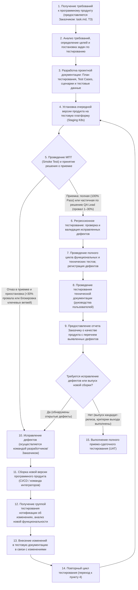
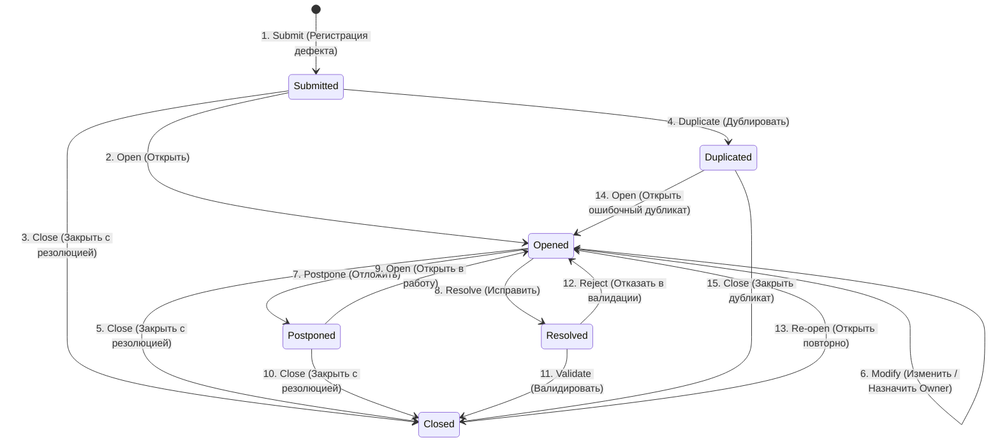

# ПЛАН ТЕСТИРОВАНИЯ

**Product version v 1.0.0**

> **Оговорка о принятых допущениях:** Все имена и фамилии участников команды, наименования юридических лиц (организаций Заказчика и Исполнителя), физические адреса, конкретные ревизии ПО, модели клиентских и серверных устройств, количественные оценки трудозатрат и календарные даты, которые явно не заданы в исходном Паспорте продукта (`task.md`), являются условными, введены для полноты документа и приняты как проектные допущения. В тексте документа такие элементы дополнительно отмечены маркером **«(Допущение)»**.

| Параметр | Значение |
| --- | --- |
| **Предоставлено для:** | ООО «БукСфера Ритейл» — Заказчик *(Допущение)* |
| **Предоставил:** | Департамент обеспечения качества ООО «ТехноСофт QA» *(Допущение)* |
| **Дата:** | 29 октября 2026 г. *(Допущение)* |
| **Версия:** | V 1.0.0 |
| **Исполнитель:** | Алексей Смирнов (ASM), Руководитель группы тестирования *(Допущение)* |

**2026**
**BookSphere**

---

## История изменений

| Версия | Дата | Автор | Комментарии |
| --- | --- | --- | --- |
| V1.0.0 | 29.10.2026 *(Допущение)* | Алексей Смирнов (ASM) *(Допущение)* | Первичная разработка и утверждение плана тестирования для комплексной проверки релиза BookSphere v1.0.0 перед промышленным запуском. |

---

## Содержание

1. СПИСОК СОКРАЩЕНИЙ И АББРЕВИАТУР
2. ВВЕДЕНИЕ
    * 2.1. СОДЕРЖАНИЕ ДОКУМЕНТА
    * 2.2. ЦЕЛЬ ДОКУМЕНТА
    * 2.3. ЦЕЛЕВАЯ АУДИТОРИЯ
    * 2.4. ССЫЛКИ НА ПРОЕКТНУЮ ДОКУМЕНТАЦИЮ
    * 2.5. ОБЗОР ПРОГРАММНОГО ПРОДУКТА
    * 2.6. ЦЕЛИ ТЕСТИРОВАНИЯ
3. ОБЪЕМ ТЕСТИРОВАНИЯ
    * 3.1. ПЕРЕЧЕНЬ ТЕСТИРУЕМЫХ КОМПОНЕНТОВ
    * 3.2. НЕТЕСТИРУЕМЫЕ КОМПОНЕНТЫ
4. ТРЕБУЕМЫЕ РЕСУРСЫ
    * 4.1. ПРОЕКТНАЯ КОМАНДА
    * 4.2. ТЕСТОВАЯ КОНФИГУРАЦИЯ
5. СТРАТЕГИЯ ТЕСТИРОВАНИЯ
    * 5.1. ФУНКЦИОНАЛЬНОЕ ТЕСТИРОВАНИЕ
        * 5.1.1. МИНИМАЛЬНЫЙ ПРИЕМОЧНЫЙ ТЕСТ (SMOKE TEST)
        * 5.1.2. РЕГРЕССИОННОЕ ТЕСТИРОВАНИЕ
        * 5.1.3. ФУНКЦИОНАЛЬНЫЙ ТЕСТ
    * 5.2. АВТОМАТИЗИРОВАННОЕ ТЕСТИРОВАНИЕ
    * 5.3. ТЕХНИЧЕСКОЕ ТЕСТИРОВАНИЕ
6. МЕТОДОЛОГИЯ ТЕСТИРОВАНИЯ
    * 6.1. ОБЗОР ПРОЦЕССА
    * 6.2. ТЕСТОВАЯ ДОКУМЕНТАЦИЯ
    * 6.3. ДОСТАВКА НОВЫХ ВЕРСИЙ ПРОГРАММНОГО ПРОДУКТА
        * 6.3.1. ПРОЦЕСС ДОСТАВКИ
        * 6.3.2. КРИТЕРИИ ПРИЕМКИ НА ТЕСТИРОВАНИЕ
    * 6.4. УПРАВЛЕНИЕ ДЕФЕКТАМИ
        * 6.4.1. ОПРЕДЕЛЕНИЕ СТЕПЕНИ ВАЖНОСТИ ДЕФЕКТОВ
        * 6.4.2. ОПРЕДЕЛЕНИЕ ПРИОРИТЕТА ДЕФЕКТОВ
        * 6.4.3. ЦИКЛ ЖИЗНИ ДЕФЕКТА
        * 6.4.4. МАТРИЦА ПЕРЕХОДОВ
        * 6.4.5. ПРОЦЕСС ВЗАИМОДЕЙСТВИЯ КОМАНД ТЕСТИРОВАНИЯ И РАЗРАБОТКИ ПО ПРИ РАБОТЕ С ДЕФЕКТ-ТРЕКИНГОВОЙ СИСТЕМОЙ
        * 6.4.6. РЕГИСТРАЦИЯ ДЕФЕКТОВ
        * 6.4.7. КРИТЕРИИ КАЧЕСТВА ПРОДУКТА
        * 6.4.8. ПРАВИЛА НАИМЕНОВАНИЯ ПОЛЬЗОВАТЕЛЕЙ СИСТЕМЫ CQ
        * 6.4.9. ПРАВИЛА ВЕДЕНИЯ ПЕРЕПИСКИ
7. ГРАФИК ТЕСТИРОВАНИЯ
    * 7.1. ССЫЛКА НА ПРОЕКТНЫЙ ПЛАН
    * 7.2. ОБЩАЯ ОЦЕНКА ВРЕМЕННЫХ ЗАТРАТ
8. ОЦЕНКА РИСКОВ ПРОЕКТА ТЕСТИРОВАНИЯ
9. ОТЧЕТЫ О РЕЗУЛЬТАТАХ ТЕСТИРОВАНИЯ
    * 9.1. ЖУРНАЛ ТЕСТИРОВАНИЯ
    * 9.2. ПРОТОКОЛ ТЕСТИРОВАНИЯ
    * 9.3. ОТЧЕТ О ЗАРЕГИСТРИРОВАННЫХ ДЕФЕКТАХ

---

## 1 СПИСОК СОКРАЩЕНИЙ И АББРЕВИАТУР

| Сокращение / аббревиатура | Описание |
| --- | --- |
| **Заказчик** | Организация (ООО «БукСфера Ритейл» *(Допущение)*), в интересах которой разрабатывается программный продукт «BookSphere», имеющая полномочия утверждать требования к программному продукту и принимать результат разработок. |
| **Дефолтное значение** | Значение поля по умолчанию. |
| **Дефект** | Несоответствие программного продукта установленному требованию спецификации. |
| **План тестирования** | Документ, описывающий объем, методы, ресурсы, стратегию и задачи тестирования платформы «BookSphere». |
| **Продукт** | Масштабируемая e-commerce платформа «BookSphere», произведенная в ходе выполнения проекта. |
| **Проект** | Ограниченная во времени деятельность, направленная на разработку и вывод в эксплуатацию платформы «BookSphere». |
| **Тестовый сценарий** | Документ (чек-лист), содержащий перечень проверок для группы функционала продукта без спецификации используемых тестовых данных и обеспечивающий функциональное покрытие тестами, стремящееся к 100%; включает проверки полей, доступных опций, графического интерфейса, целостности вводимой информации, динамического поведения полей, дефолтных значений, системные проверки, корректность сохранения данных и защиту от несанкционированного доступа. |
| **Тестовый случай (Test Case)** | Документ в системе TestRail *(Допущение)*, содержащий детальное описание теста для одной или более функций с обозначением конкретных предусловий, тестовых данных, шагов выполнения и ожидаемого результата теста. |
| **Набор тестовых данных** | Документ или дамп БД/файлов (CSV, XML, фикстуры JSON), содержащий набор пререквизитов для последующего применения в процессах функционального, нагрузочного и автоматизированного тестирования. |
| **Smoke Test (МПТ)** | Минимальный приемочный тест на работоспособность ключевых узлов сборки. |
| **PIM / OMS** | Product Information Management (система управления каталогом товаров) / Order Management System (система управления заказами). |
| **DRM** | Digital Rights Management — технические средства защиты авторских прав (шифрование электронных и аудиокниг от нелегального копирования). |
| **SLA** | Service Level Agreement — соглашение об уровне доступности сервиса (для BookSphere — 99.9%). |
| **UAT** | User Acceptance Testing — пользовательское приемочное тестирование. |

---

## 2 ВВЕДЕНИЕ

### 2.1 Содержание документа

Настоящий документ содержит описание процесса тестирования, стратегии, видов и подходов к тестированию комплексной e-commerce системы «BookSphere» (Web-витрины, мобильного приложения на iOS/Android, микросервисного Backend, административной панели PIM/OMS и внешних интеграций).
В документе также регламентировано взаимодействие группы тестирования и команды разработчиков в процессе контроля качества приложения, правила управления дефектами, критерии приемки и график работ на этапе «QA и Нагрузочное тестирование».

### 2.2 Цель документа

* Спланировать управление тестированием и техническую поддержку тестирования в ходе жизненного цикла разработки платформы «BookSphere»;
* Обеспечить полноту тестирования в соответствии с функциональными и нефункциональными требованиями к продукту, охватить все необходимые виды тестирования и описать требуемую проектную документацию;
* Организовать прозрачный контроль процесса тестирования, определить методы регистрации дефектов, необходимое инструментальное программное обеспечение и виды предоставления отчетов;
* Определить понедельный график работ, описать используемую методологию и стратегию тестирования;
* Зафиксировать критерии входа, выхода, приостановки/возобновления тестирования и критерии качества продукта;
* Определить человеческие, аппаратные и программные ресурсы, необходимые для реализации проекта тестирования;
* Описать тестовые артефакты и документацию, необходимую для обеспечения тестирования по проекту.

### 2.3 Целевая аудитория

Документ предназначен для последующего использования сотрудниками группы тестирования проекта «BookSphere» (QA Lead, функциональными тестировщиками, инженерами по автоматизации и нагрузочному тестированию) и служит для понимания целей и содержания работ по тестированию программного продукта, определяет и описывает перечень работ и этапы тестирования приложения.
Также документ предназначен для ознакомления команды разработчиков, системных аналитиков, DevOps-инженеров и представителей Заказчика с процессами взаимодействия с группой тестирования, методами регистрации и отслеживания текущего состояния дефектов, критериями приемки сборок и предоставляемой по проекту тестовой документацией.

### 2.4 Ссылки на проектную документацию

План тестирования основан и имеет ссылки на следующую проектную документацию *(наименования файлов ниже, кроме `task.md`, — Допущение)*:

* **[1] BookSphere_Roadmap_2026.mpp** (Проектный план временных затрат, сроки и даты доставки промежуточных результатов, Этап 5 «QA и Нагрузочное тестирование»);
* **[2] BookSphere_SRS_v1.0.doc (task.md)** (Паспорт программного продукта и Техническое задание на разработку платформы «BookSphere»);
* **[3] BookSphere_User_Guide.doc** (Руководство пользователей клиентской витрины, мобильного приложения и операторов Back-office PIM/OMS);
* **[4] Техническое_тестирование_BookSphere.doc** (Сценарии нагрузочного, стресс-тестирования, проверки безопасности, DRM и отказоустойчивости);
* **[5] Журнал_тестирования_BookSphere.xlsx** (Сводная таблица выполнения тестовых прогонов по сборкам);
* **[6] Сценарии_тестирования_BookSphere.xlsx** (Выгрузка тест-кейсов и чек-листов из TMS TestRail).

### 2.5 Обзор программного продукта

«BookSphere» — это масштабируемая e-commerce платформа нового поколения, предназначенная для продажи печатных книг, электронных книг (e-books) и аудиокниг для сегментов B2C (частные покупатели) и B2B (библиотеки, вузы, корпоративные клиенты), а также для работы по моделям подписки (Subscription) и маркетплейса.
Продукт построен по архитектуре **Headless Commerce** на базе контейнеризированных микросервисов (Kubernetes):

* **Клиентский уровень (Frontend):** Web-приложение на базе Next.js (React) с поддержкой SSR/SSG и кроссплатформенное мобильное приложение на Flutter (iOS и Android) со встроенным гибридным ридером/аудиоплеером (функция Immersion Reading и оффлайн-режим).
* **Серверный уровень (Backend):** API Gateway (Kong или AWS API Gateway), микросервис каталога и умного поиска на Python (FastAPI) + Elasticsearch, сервис корзины и заказов на Node.js (NestJS), сервис аутентификации на Go (Gin) + Keycloak, модуль AI-рекомендаций на Python (PyTorch/TensorFlow) и Headless CMS Strapi или Sanity.
* **Хранение данных и безопасность контента:** PostgreSQL (заказы, пользователи, финансы), Redis (кэш, сессии, корзины), MongoDB (отзывы, логи), S3 Object Storage (медиафайлы, обложки) и выделенный **DRM-сервер** для криптографической защиты электронных и аудиокниг от нелегального копирования.

### 2.6 Цели тестирования

Основными целями тестирования платформы «BookSphere» являются:

* Выявление проблем и дефектов, связанных с несоответствием функциональным и нефункциональным требованиям к разрабатываемому программному продукту (включая показатели SLA 99.9%, время отклика API < 200 мс при 10 000 одновременных пользователей, стандарты PCI DSS и 152-ФЗ/GDPR);
* Отслеживание статуса проблем и контроль их своевременного устранения до релиза;
* Предоставление Заказчику объективной суммарной оценки качества продукта и его готовности к промышленной эксплуатации (Soft Launch);
* Снижение коммерческих, репутационных и технических рисков проекта, связанных с качеством разрабатываемого продукта (потери платежей, утечки цифрового DRM-контента, недоступность витрины в период распродаж).

---

## 3 ОБЪЕМ ТЕСТИРОВАНИЯ

### 3.1 Перечень тестируемых компонентов

Описание компонентов системы «BookSphere», подлежащих тестированию в рамках релиза v1.0.0, а также приоритизация функций по степени риска (High / Medium / Low) с обоснованием представлены в таблице ниже:

| Наименование приложения/компонента | Наименование группы функций (модуля) | Функции / Ссылки / Комментарии | Приоритет по риску и обоснование |
| --- | --- | --- | --- |
| **1. Клиентская часть (Витрина Web и Mobile App)** | **Умный каталог и Поиск** | Поиск на базе Elasticsearch с учетом опечаток, синонимов и морфологии; фильтрация по жанрам, авторам, издательствам, году выпуска, рейтингу, цене, формату (бумага/PDF/MP3); сортировка выдачи. | **High (Высокий):** Поиск и фильтрация — основная точка входа в воронку продаж. Ошибки здесь напрямую снижают конверсию в покупку. |
| **1. Клиентская часть (Витрина Web и Mobile App)** | **Карточка товара** | Переключение форматов покупки (печатная, электронная, аудио); фрагмент для ознакомления (Look Inside) с защитой от копирования; видеообзоры, инфографика сюжета, блок «Похожие книги»; публикация и отображение отзывов с фото/видео (модерация). | **High (Высокий):** Ошибки выбора формата или цены блокируют покупку; уязвимости в Look Inside ведут к нарушению авторских прав. |
| **1. Клиентская часть (Витрина Web и Mobile App)** | **Личный кабинет и Аутентификация** | Регистрация/авторизация через Keycloak, управление ролями (B2C, B2B, продавец); история заказов и трекинг доставки в реальном времени; раздел «Моя библиотека» с синхронизацией прогресса чтения/прослушивания между Web и Mobile; система лояльности (кэшбэк бонусами, уровни, персональные скидки); Wishlist и совместные вишлисты. | **High (Высокий):** Нарушение синхронизации библиотеки или потеря доступа к купленным книгам/бонусам вызывает критический отток пользователей. |
| **1. Клиентская часть (Mobile App / Web)** | **Гибридный ридер и DRM-защита** | Чтение e-books и прослушивание аудиокниг; функция Immersion Reading (синхронная подсветка текста с голосом чтеца); оффлайн-режим в мобильном приложении; проверка шифрования файлов через DRM-сервер и запрета выгрузки исходников. | **High (Высокий):** Ключевое конкурентное преимущество (USP) и юридическое требование правообладателей (Литрес, Storytel, издательства). |
| **1. Клиентская часть (Витрина)** | **AI-рекомендации и Социальные функции** | Формирование персональной ленты «Для вас» (коллаборативная фильтрация на основе прочитанного и оценок); работа встроенных «Книжных клубов», голосовых рецензий и публичных полок с друзьями. | **Medium (Средний):** Влияет на удержание (Retention) и средний чек, но сбой рекомендаций не блокирует базовую покупку книги через каталог. |
| **2. Оформление заказа (Checkout)** | **Корзина и Оформление заказа** | Гостевой checkout (без обязательной регистрации); расчет стоимости и сроков доставки; применение промокодов, подарочных сертификатов и списание/начисление бонусов; выбор способа оплаты (карты, СБП, крипто-кошельки, рассрочка/сплит); оформление подписки («Все включено») и B2B-лицензий. | **High (Высокий):** Прямое влияние на выручку платформы. Любая ошибка расчета итоговой суммы или блокировка кнопки оплаты ведет к потере денег. |
| **3. Административная панель (Back-office)** | **Управление каталогом (PIM-система)** | Массовый импорт/экспорт каталога (CSV, XML, API); управление атрибутами книг, авторами, книжными сериями и карточками сторонних продавцов маркетплейса. | **Medium (Средний):** Внутренний функционал; при ошибке импорта есть возможность повторной загрузки файла администратором. |
| **3. Административная панель (Back-office)** | **Управление заказами (OMS)** | Воркфлоу переходов статусов заказа; автоматическое распределение заказов по складам; генерация и печать товарных накладных и штрихкодов. | **High (Высокий):** Ошибки распределения заказов или генерации штрихкодов останавливают отгрузку печатных книг со склада. |
| **3. Административная панель (Back-office)** | **Маркетинг, Контент (CMS) и Аналитика (BI)** | Конструктор лендингов, управление баннерами, рассылками, ведение блога в Strapi / Sanity; модерация отзывов; дашборды с метриками (LTV, CAC, конверсия, ABC-анализ ассортимента, прогнозирование спроса). | **Low (Низкий):** Дефекты верстки блога или задержки обновления BI-дашбордов не влияют на работоспособность клиентских покупок в реальном времени. |
| **4. Внешние интеграции (API Шлюзы)** | **Платежи, Логистика, ERP, CRM, Коммуникации, Контент** | Интеграция с платежными шлюзами (ЮKassa, CloudPayments, Stripe); логистикой (Shiptor, GotoRoute для СДЭК, Почты России, Boxberry, Яндекс.Доставки); ERP (1С:Предприятие, МойСклад — двусторонний обмен остатками и ценами); CRM (Bitrix24/amoCRM); шлюзами уведомлений (SendGrid, Twilio/SMS.ru, Telegram Bot API); API поставщиков контента (Литрес, Storytel). | **High (Высокий):** Рассинхронизация остатков с 1С, потеря коллбэков об оплате от ЮKassa/Stripe или невыдача DRM-ключа от агрегатора приводят к финансовым и юридическим претензиям. |

Тестированию на первой итерации подлежат все перечисленные функции системы как изолированно — тестирование работы функций внутри отдельных микросервисов и модулей, так и в целом — интеграционное тестирование взаимодействия модулей системы, сквозное выполнение бизнес-процессов (E2E: от поиска книги и оплаты до получения чека, синхронизации с 1С и чтения в ридере), проверка полных циклов жизни заказов и электронных лицензий.
Проводится тестирование работы системы в различных клиентских конфигурациях (Web-браузеры, мобильные ОС iOS и Android).
В процессе проведения работ по тестированию на второй и последующих итерациях предполагается проведение регрессионного тестирования — проверка исправления дефектов, зарегистрированных на первой итерации, тест доработанной функциональности, повторная проверка сквозных бизнес-процессов.
Подробно перечень тестируемых компонентов и сценариев приведен в тестовой документации, смотри пункт 6.2 «Тестовая документация».

### 3.2 Нетестируемые компоненты

В рамках текущего цикла тестирования релиза «BookSphere» v1.0.0 исключены из объема проверок следующие компоненты и функции по указанным причинам:

1. **Внутренняя логика и инфраструктура сторонних внешних сервисов** (платежные системы ЮKassa, CloudPayments, Stripe; логистические провайдеры и агрегаторы СДЭК, Почта России, Boxberry, Яндекс.Доставка, Shiptor, GotoRoute; внутренние алгоритмы 1С:Предприятие, МойСклад, Bitrix24, amoCRM, SendGrid, Twilio/SMS.ru, Литрес, Storytel). **Причина:** данные системы являются внешними проприетарными платформами третьих лиц. Команда QA проверяет исключительно **контрактную интеграцию** с ними (корректность формирования исходящих запросов от BookSphere, обработку ответов, вебхуков, таймаутов и кодов ошибок на тестовых песочницах / mock-серверах).
2. **Базовая функциональность сторонних инфраструктурных и коробочных решений** (внутренние механизмы СУБД PostgreSQL, Redis, MongoDB, движка Elasticsearch, брокера Keycloak и административного ядра Strapi / Sanity CMS). **Причина:** указанные продукты протестированы их вендорами; проверке подлежат только кастомные схемы данных, конфигурация, плагины и API-взаимодействие внутри архитектуры BookSphere.
3. **Клиентские приложения для Smart TV и навыки для голосовых ассистентов**. **Причина:** несмотря на то, что архитектура Headless Commerce закладывает фундамент для этих каналов продаж, разработка клиентских интерфейсов для Smart TV и голосовых ассистентов не входит в объем этапов MVP и Full-версии (раздел 9 Паспорта продукта) и запланирована на фазу пострелизного развития *(Допущение)*.
4. **Модуль «AR-витрина»** (наведение камеры смартфона на физическую книгу в партнерском оффлайн-магазине для просмотра трейлера и отзывов) и **модуль «Эко-трекинг»** (расчет углеродного следа от доставки с посадкой виртуального и реального дерева). **Причина:** по согласованию с Заказчиком данные имиджевые USP-функции вынесены в бэклог релиза v1.1 (фаза развития по Agile/Scrum после Soft Launch) *(Допущение)*. Это сделано для концентрации ресурсов тестирования на бизнес-критичном ядре релиза v1.0.0 (витрина, Checkout, платежи, DRM-защита, мобильный гибридный ридер и высокая нагрузка), а также по причине незавершенности юридической контрактации с партнерскими оффлайн-сетями и экологическими фондами к моменту старта QA-этапа *(Допущение)*.

---

## 4 ТРЕБУЕМЫЕ РЕСУРСЫ

### 4.1 Проектная команда

| Роль | Имя и Фамилия | Место нахождения | Ответственность |
| --- | --- | --- | --- |
| **Руководитель группы тестирования (QA Lead)** | Алексей Смирнов (ASM) *(Допущение)* | г. Москва, ул. Лесная, д. 7 *(Допущение)* | 1) Контактное лицо по всем проектным вопросам качества с Заказчиком и командой разработки; 2) Написание и актуализация проектной тестовой документации (План тестирования, итоговые отчеты), ревью сценариев тестирования; 3) Управление рисками тестирования, контроль сроков и распределение задач в Jira/TestRail; 4) Верификация и триаж зарегистрированных дефектов, контроль соблюдения критериев входа/выхода; 5) Участие в приемочном и функциональном тестировании критичных модулей (Checkout, OMS). |
| **Функциональный тестировщик (Manual QA — 2 чел.)** *(Допущение)* | Мария Иванова (MIV), Дмитрий Козлов (DKO) *(Допущение)* | г. Москва, ул. Лесная, д. 7 / г. Санкт-Петербург *(Допущение)* | 1) Ручное функциональное, UI/UX, кроссбраузерное и мобильное тестирование (Web, iOS, Android); 2) Разработка и актуализация сценариев тестирования (чек-листов) и детальных тест-кейсов в TestRail; 3) Ручное тестирование API и внешних интеграций (платежи, доставка, 1С, CRM), проверка DRM-защиты и гибридного ридера; 4) Регистрация дефектов и ретест исправлений. |
| **Технический тестировщик (QA Automation / Performance / Security Engineer — 2 чел.)** *(Допущение)* | Сергей Волков (SVO), Елена Новикова (ENO) *(Допущение)* | г. Москва, ул. Лесная, д. 7 *(Допущение)* | 1) **Техническое тестирование:** 1.1) Разработка профилей нагрузки и проведение нагрузочного тестирования (до 10 000 одновременных пользователей); 1.2) Тестирование производительности микросервисов и БД (контроль SLA времени ответа API < 200 мс); 1.3) Стресс-тестирование и проверка отказоустойчивости (Auto-scaling в K8s, SLA 99.9%); 1.4) Тестирование узких мест (bottlenecks) и аудит безопасности (SQLi, XSS, PCI DSS, 152-ФЗ/GDPR, устойчивость к DDoS). 2) **Автоматизация функционального тестирования:** 2.1) Разработка наборов тестовых данных (фикстур каталога, пользователей и заказов); 2.2) Подготовка и настройка среды в GitLab CI для проведения автоматизированных тестов; 2.3) Разработка и поддержка автотестов (UI Web/Mobile, API) для Smoke и регрессионного тестирования. |

### 4.2 Тестовая конфигурация

Разработанный программный продукт «BookSphere» должен быть развернут в изолированном тестовом контуре (Staging / Pre-Prod в Yandex Cloud / AWS, идентичном Production по архитектуре Kubernetes) и протестирован на следующем аппаратном и программном оборудовании:

| № | Роль | Конфигурация аппаратного обеспечения *(Допущение)* | Конфигурация программного обеспечения *(Актуально на 2026 г.)* |
| --- | --- | --- | --- |
| **1** | **Сервер баз данных и хранилищ / Агент сбора метрик при нагрузочном тестировании** | Cloud VM (Yandex Cloud / AWS): 16 vCPU, 64 GB RAM, 1 TB NVMe SSD, 10 GBit/s сеть *(Допущение)* | Linux Server (актуальная стабильная LTS-версия на момент старта этапа QA) *(Допущение)*; СУБД и сервисы (PostgreSQL, Redis, MongoDB, Elasticsearch, S3-совместимое хранилище, DRM-сервер) — **актуальная стабильная версия на момент старта этапа QA** (2026 г.); Prometheus Node Exporter & Database Agents, ELK Stack. |
| **2** | **Сервер приложения (Application Server — K8s Cluster)** | Кластер из 4 нод (с автоскейлингом до 12 нод): каждая по 8 vCPU, 32 GB RAM, 250 GB SSD, 10 GBit/s сеть *(Допущение)* | Managed Kubernetes (K8s — **актуальная стабильная версия на момент старта этапа QA**), Docker, Kong API Gateway / AWS API Gateway; микросервисы на Python (FastAPI, PyTorch/TensorFlow), Node.js (NestJS), Go (Gin), Keycloak, Strapi / Sanity CMS, Next.js (React SSR/SSG) — **актуальная стабильная версия на момент старта этапа QA**; Prometheus + Grafana, Sentry. |
| **3** | **Управляющий сервер для нагрузочного и автоматизированного тестирования / Генератор нагрузки** | Выделенный облачный кластер из 3 нод: 8 vCPU, 32 GB RAM, 200 GB SSD, 10 GBit/s сеть *(Допущение)* | Linux Server, Apache JMeter / k6, OWASP ZAP, GitLab Runner, Playwright, Appium Server, Charles Proxy / Wireshark — **актуальная стабильная версия на момент старта этапа QA** *(Допущение)*. |
| **4** | **Клиентские рабочие станции и мобильный стенд для функционального и кроссплатформенного тестирования** | **ПК 1 (Win):** Intel Core i7, 32 GB RAM, 512 GB SSD (1920x1080, 2560x1440) *(Допущение)*; **ПК 2 (Mac):** Apple MacBook Pro (Apple Silicon), 16 GB RAM *(Допущение)*; **Мобильные устройства** *(Допущение)*: — смартфоны и планшеты Apple (iPhone 16 Pro / 17 Pro, iPad Air); — смартфоны и планшеты на базе Android (Samsung Galaxy S25 / S26, Xiaomi 15, Samsung Galaxy Tab S10). | **ОС Десктоп** *(Допущение)*: MS Windows 11, macOS 26; **ОС Мобайл** *(Допущение)*: iOS 26+ / iPadOS 26+, Android 15 / 16+; **Браузеры (актуальные стабильные версии на момент старта этапа QA):** Google Chrome, Mozilla Firefox, Apple Safari, Яндекс.Браузер, Microsoft Edge *(Допущение)*; **Инструменты QA** *(Допущение)*: Postman, DBeaver, Android Studio / Xcode, BrowserStack. |

Для конфигурации серверной и тестовой платформы используются изолированные облачные узлы и реальные физические клиентские устройства по каждой из ролей. Это позволяет максимально приблизить условия тестирования к промышленной эксплуатации (Production) и обеспечить полное покрытие матриц совместимости. Для выполнения нагрузочных тестов (до 10 000 виртуальных пользователей) используется управляющий сервер (Master), а на подчиненных узлах (Slaves) запускаются генераторы трафика. Агенты мониторинга (Prometheus/Grafana) на серверах баз данных и в кластере Kubernetes отвечают за сбор статистики об использовании CPU, RAM, дискового I/O, сетевых задержек и времени отклика подов.

**Выбор и обоснование инструментария тестирования *(Допущение)*:**

* **Jira (с адаптацией схемы состояний под регламент ClearQuest):** управление задачами и дефектами — единая среда с командой разработки, прозрачная трассируемость багов к требованиям.
* **TestRail:** система управления тестами (TMS) — централизованное хранение тест-кейсов, чек-листов, формирование тест-планов и выгрузка Журнала и Протоколов тестирования в Excel.
* **Postman + Swagger/OpenAPI:** функциональное и интеграционное тестирование REST API микросервисов и вебхуков внешних систем (ЮKassa, СДЭК, 1С) — быстрая отладка JSON-контрактов и коллекций.
* **Playwright (TypeScript) и Appium (Flutter Driver):** автоматизация E2E-тестов для Web (Next.js) и мобильных приложений (Flutter iOS/Android) — высокая скорость выполнения, нативная работа с современным стеком и параллельный запуск в GitLab CI.
* **Apache JMeter / k6 + Grafana/Prometheus:** нагрузочное и стресс-тестирование — способность генерировать 10 000+ конкурентных соединений при минимальном потреблении ресурсов генератора и детальная визуализация времени отклика (< 200 мс).
* **OWASP ZAP + SQLMap + Burp Suite:** тестирование информационной безопасности — автоматизированное сканирование уязвимостей OWASP Top 10, проверка защиты от SQL-инъекций и перехват трафика для проверки DRM-шифрования.

---

## 5 СТРАТЕГИЯ ТЕСТИРОВАНИЯ

Основным методом проверки программного продукта «BookSphere» является комбинированное тестирование с использованием метода «черного ящика» (базирующегося на требованиях и спецификациях Паспорта продукта) и метода «серого ящика» (при проверке API микросервисов, структуры БД PostgreSQL/Redis/MongoDB, очередей и логов в ELK/Sentry).
В процессе тестирования платформы «BookSphere» применяются следующие виды тестирования (с указанием цели, техники выполнения и критерия завершения для каждого вида):

### 5.1 Функциональное тестирование

Функциональное тестирование — это процесс проверки «BookSphere» на предмет соответствия функциональным требованиям и правильности реализации бизнес-логики. Данный раздел включает следующие виды и этапы:

#### 5.1.1 Минимальный приемочный тест (Smoke test)

МПТ — короткий тест, проверяющий основную функциональность сборки и ее пригодность к дальнейшим проверкам, длящийся не более 1 часа (при автозапуске — до 15 минут *(Допущение)*). Выполняется для каждой новой поставленной версии продукта перед началом основного цикла тестирования.

* **Цель:** Оперативное подтверждение жизнеспособности новой сборки (доступность витрины, работа поиска, открытие карточки книги, добавление в корзину, успешная авторизация, доступность PIM/OMS) и отсутствие критических регрессий.
* **Техника:** Прогон фиксированного набора позитивных E2E-сценариев по критическому пути пользователя (Critical Path) в автоматическом режиме (Playwright/Postman *(Допущение)*) и визуальная выборочная проверка тестировщиком.
* **Критерий завершения и единое правило принятия решения по Smoke-тесту:**
    * **100% успешное прохождение (Pass = 100%, 0 дефектов уровня Critical/Blocker):** полная приемка сборки к дальнейшему циклу тестирования (а также обязательное условие для возобновления тестирования после приостановки);
    * **Провал от 1% до 30% проверок включительно:** частичная приемка сборки по решению руководителя группы тестирования (QA Lead) для проверки незатронутых модулей (при условии, что не заблокированы сквозные ключевые ветви функциональности);
    * **Провал более 30% проверок (либо блокировка ключевых ветвей функциональности):** полный отказ в приемке сборки и приостановка тестирования до выпуска исправленного билда.

#### 5.1.2 Регрессионное тестирование

На каждом последующем этапе после внесения исправлений или доработок производится регрессионное тестирование ранее проверенной функциональности и ее совместимости с изменениями.

* **Цель:** Убедиться, что исправление дефектов не породило новых ошибок (side-effects) в смежных модулях и ранее работавший функционал функционирует корректно.
* **Техника:** Повторное прохождение тест-кейсов из регрессионного набора (автоматизированный прогон API и UI-тестов + ручная проверка затронутых областей и валидация исправленных дефектов со статусом `Resolved`).
* **Критерий завершения:** Выполнено 100% регрессионного набора тест-кейсов; все ранее закрытые дефекты не воспроизводятся повторно; отсутствуют открытые регрессионные дефекты уровня `Critical` и `Major`.

#### 5.1.3 Функциональный тест (включая Интеграционное, API, UI/UX, Кроссбраузерное и Приемочное тестирование)

Основной вид тестирования, во время которого проверяется вся функциональность «BookSphere» при стандартном и нестандартном использовании с применением полного объема созданной тестовой документации. В рамках данной группы выполняются следующие специализированные виды проверок:

1. **Функциональное тестирование бизнес-логики (Web, Mobile, Back-office):**
    * **Цель:** Обеспечить максимально возможное покрытие тестами всех модулей продукта (Каталог, Поиск с морфологией и опечатками, Карточка книги, Личный кабинет, лояльность, гибридный ридер с Immersion Reading, Checkout, подписки, B2B-лицензии, PIM, OMS, CMS и BI).
    * **Техника:** Классы эквивалентности, анализ граничных значений (переполнение полей, лимиты бонусов и промокодов, ввод спецсимволов), таблицы принятия решений (расчет скидок и доставки), диаграммы переходов состояний (воркфлоу статусов заказа в OMS).
    * **Критерий завершения:** Выполнено 100% запланированных функциональных тест-кейсов в TestRail *(Допущение)*; критические и серьезные дефекты устранены.

2. **Тестирование API и Интеграционное тестирование:**
    * **Цель:** Проверить корректность взаимодействия внутренних микросервисов через Kong API Gateway / AWS API Gateway и надежность обмена данными с внешними системами (ЮKassa, CloudPayments, Stripe, Shiptor, GotoRoute, СДЭК, Почта России, Boxberry, Яндекс.Доставка, 1С:Предприятие, МойСклад, Bitrix24/amoCRM, SendGrid, Twilio/SMS.ru, Telegram Bot, API Литрес и Storytel).
    * **Техника:** Контрактное тестирование REST API в Postman *(Допущение)* (проверка HTTP-статусов 2xx/4xx/5xx, JSON-схем, идемпотентности платежных запросов, корректной обработки вебхуков, эмуляция недоступности внешних шлюзов через mock-серверы).
    * **Критерий завершения:** Проверены все задокументированные эндпоинты в спецификации OpenAPI и все 6 групп внешних интеграций; данные консистентно передаются между PostgreSQL, 1С и CRM без потерь и дублей.

3. **Тестирование пользовательского интерфейса и удобства использования (UI/UX):**
    * **Цель:** Проверить соответствие верстки макетам дизайн-системы (UI-кит), плавность микроанимаций (Tailwind CSS, Framer Motion), адаптивность и удобство навигации (CJM) для пользователей.
    * **Техника:** Попиксельное и визуальное сравнение с макетами дизайна, проверка состояний элементов (hover, focus, disabled, skeleton-загрузчики), проверка доступности (контрастность, читаемость шрифтов в электронном ридере).
    * **Критерий завершения:** Проверены все экраны Web и Mobile; отсутствуют дефекты верстки (перекрытие элементов, обрезание текста, горизонтальный скролл), мешающие восприятию контента или нажатию кнопок.

4. **Кроссбраузерное и кроссплатформенное тестирование (Web, iOS, Android):**
    * **Цель:** Обеспечить идентичную работоспособность и корректное отображение платформы на различных браузерах, десктопных и мобильных ОС и разрешениях экранов.
    * **Техника:** Матричное тестирование ключевых сценариев на актуальных стабильных версиях браузеров Google Chrome, Apple Safari, Mozilla Firefox, Microsoft Edge, Яндекс.Браузер (на десктопных ОС **Windows 11** и **macOS 26** *(Допущение)*) и нативных сборках Flutter-приложения на смартфонах и планшетах под управлением **iOS 26+ / iPadOS 26+** и **Android 15 / 16+** *(Допущение)* (включая фоновое воспроизведение аудиокниг, пуш-уведомления и оффлайн-режим).
    * **Критерий завершения:** Сквозные сценарии успешно пройдены на 100% целевых конфигураций из раздела 4.2 без специфичных для платформы критических или серьезных сбоев.

5. **Приемочное тестирование (UAT — User Acceptance Testing):**
    * **Цель:** Финальное подтверждение готовности продукта к релизу со стороны представителей Заказчика и бизнес-пользователей (контент-менеджеров, маркетологов, операторов склада и колл-центра).
    * **Техника:** Демонстрация и самостоятельное выполнение Заказчиком сквозных бизнес-сценариев по согласованному чек-листу приемо-сдаточных испытаний на Pre-Prod окружении.
    * **Критерий завершения:** Подписание Заказчиком Протокола приемочного тестирования без замечаний уровня `Critical` и `Major`.

### 5.2 Автоматизированное тестирование

Основной целью автоматизации тестирования на проекте «BookSphere» является ускорение проверок регулярных сборок в CI/CD-конвейере и выполнение рутинных регрессионных и контрактных проверок при минимальном привлечении ручных ресурсов в сжатые сроки.

* **Цель:** Сократить время проведения Smoke-тестов до 15 минут и регрессионного прогона до 2 часов *(Допущение)* при каждом выкате релиза в GitLab CI / GitHub Actions.
* **Техника:** Разработка скриптов на базе паттерна Page Object Model (Playwright для Web Next.js, Appium для Flutter Mobile *(Допущение)*) и автотестов API (Pytest / Postman Newman *(Допущение)*) на основе подготовленных наборов тестовых данных.
* **Критерий завершения:** Автоматизировано 100% сценариев Smoke-тестирования и не менее 70% приоритетных (High Risk) регрессионных тест-кейсов *(Допущение)* (поиск, корзина, расчет заказа, API каталога и авторизации); автотесты интегрированы в пайплайн GitLab CI и стабильно проходят без ложных срабатываний (flaky tests < 2% *(Допущение)*).

### 5.3 Техническое тестирование

Техническое тестирование имеет своей основной целью проверку нефункциональных требований, предъявляемых к архитектуре «BookSphere», и производится техническими тестировщиками с использованием специализированного ПО (Apache JMeter / k6, OWASP ZAP *(Допущение)*, Prometheus, Grafana).
Данный вид тестирования включает в себя следующие типы тестов:

1. **Нагрузочное тестирование и тест производительности (Performance & Load Testing):**
    * **Цель:** Подтвердить способность системы обслуживать **до 10 000 одновременных пользователей** на пиковых нагрузках (например, во время книжных распродаж) при сохранении **времени ответа API < 200 мс** (для 95-го перцентиля *(Допущение)*) и корректной работе с крупной базой данных каталога и заказов.
    * **Техника:** Моделирование реалистичного профиля нагрузки в JMeter/k6 *(Допущение)* (просмотр каталога и поиск в Elasticsearch — 50%, открытие карточек и чтение фрагментов — 30%, добавление в корзину и оформление заказа в NestJS/PostgreSQL — 15%, синхронизация прогресса чтения — 5% *(Допущение)*) с плавным подъемом (Ramp-up) до 10 000 виртуальных пользователей и удержанием полки нагрузки в течение 4 часов *(Допущение)*.
    * **Критерий завершения:** При нагрузке 10 000 конкурентных пользователей 95% запросов к API выполняются быстрее 200 мс; доля ошибок (Error Rate) не превышает 0.1% *(Допущение)*; отсутствуют утечки памяти в подах K8s и блокировки (deadlocks) в PostgreSQL.

2. **Стресс-тестирование (Stress Testing):**
    * **Цель:** Проверить работоспособность системы в критических условиях, превышающих штатные (15 000 – 25 000 одновременных пользователей *(Допущение)*, исчерпание пула соединений БД и CPU), определить предел прочности (точку деградации) и способность системы к самостоятельному восстановлению после снятия пиковой нагрузки.
    * **Техника:** Ступенчатое повышение нагрузки в JMeter выше проектного максимума до момента отказа сервисов с последующим резким сбросом нагрузки до номинальной.
    * **Критерий завершения:** Определена точная граница максимальной пропускной способности (RPS); при перегрузке система не теряет целостность финансовых транзакций в БД и автоматически возвращается к штатному времени отклика (< 200 мс) в течение 3 минут *(Допущение)* после снижения нагрузки.

3. **Тестирование отказоустойчивости и масштабируемости (Failover, Recovery & Auto-scaling — SLA 99.9%):**
    * **Цель:** Подтвердить выполнение требования доступности **SLA 99.9%** (суммарный простой не более ~8,76 часа в год) и работоспособность автоматического горизонтального масштабирования (Auto-scaling) микросервисов в Kubernetes.
    * **Техника:** Искусственное отключение (Chaos Engineering) отдельных подов микросервисов, ноды Redis/PostgreSQL или разрыв связи с внешним шлюзом под нагрузкой; проверка срабатывания Horizontal Pod Autoscaler (HPA) при росте нагрузки CPU > 70% *(Допущение)* и переключения на реплику БД.
    * **Критерий завершения:** При падении контейнера или ноды K8s автоматически перенаправляет трафик на живые реплики и поднимает новые поды без прерывания пользовательских сессий; время восстановления (RTO) при сбое узла БД не превышает 60 секунд *(Допущение)*; потеря подтвержденных заказов (RPO) равна 0.

4. **Тестирование безопасности (Security Testing: PCI DSS, 152-ФЗ / GDPR, SQLi, DDoS):**
    * **Цель:** Подтвердить защищенность персональных и платежных данных пользователей, соответствие требованиям **152-ФЗ и GDPR**, стандарту **PCI DSS** при приеме банковских карт, а также устойчивость к **SQL-инъекциям**, XSS, CSRF и **DDoS-атакам**.
    * **Техника:** Инструментальное сканирование (OWASP ZAP, SQLMap *(Допущение)*) и ручной пентест полей ввода и параметров API на SQLi/NoSQLi/XSS; проверка отсутствия сохранения реквизитов карт (PAN/CVV) в БД и логах BookSphere (делегирование на сторону шлюзов ЮKassa/CloudPayments/Stripe через токенизацию и 3-D Secure); проверка шифрования ПДн (TLS 1.3 при передаче, AES-256 при хранении *(Допущение)*), механизмов согласия на обработку ПДн и права на удаление аккаунта (GDPR Right to be Forgotten); проверка правил Rate Limiting на Kong API Gateway и облачной анти-DDoS защиты (WAF).
    * **Критерий завершения:** Отсутствуют уязвимости уровня Critical, High и Medium по классификации CVSS v3 *(Допущение)*; подтверждено полное соблюдение чек-листов 152-ФЗ/GDPR и PCI DSS; Rate Limiter и WAF успешно блокируют паразитный флуд-трафик без отказа в обслуживании легитимных клиентов.

5. **Тестирование DRM-защиты цифрового контента:**
    * **Цель:** Гарантировать невозможность несанкционированного копирования, дешифровки, скачивания по прямым ссылкам (S3) и распространения файлов электронных (PDF/EPUB) и аудиокниг (MP3/AAC), а также фрагментов «Look Inside».
    * **Техника:** Попытки перехвата сетевого трафика через Charles Proxy/Burp Suite *(Допущение)* при загрузке книги в Web и Mobile (оффлайн-режим); проверка срока жизни подписанных URL (Pre-signed S3 URLs); попытка извлечения и открытия зашифрованных контейнеров книг из файловой системы Android/iOS вне приложения BookSphere; проверка привязки DRM-ключа к конкретному авторизованному аккаунту/устройству и блокировки доступа при истечении подписки.
    * **Критерий завершения:** 100% файлов книг в хранилище и кэше мобильного устройства зашифрованы; прямой доступ к S3 без валидного DRM-токена возвращает `403 Forbidden`; извлеченный из памяти устройства файл невозможно открыть сторонними ридерами или плеерами; копирование текста из защищенного режима и обход лимита устройств полностью заблокированы.

Подробное описание сценариев проведения технического тестирования приведено в документе [4].

---

## 6 МЕТОДОЛОГИЯ ТЕСТИРОВАНИЯ

### 6.1 Обзор процесса

Подход к процессу тестирования платформы «BookSphere» можно отобразить в виде следующего графика (см. Рис. 1):

*Рис. 1. Схема процесса тестирования «BookSphere»*

Данный процесс включает в себя следующие последовательные этапы:

1. Получение функциональных и нефункциональных требований к программному продукту «BookSphere» (предоставляется Заказчиком в виде Паспорта продукта `task.md`, ТЗ, OpenAPI-спецификаций и дизайн-макетов);
2. Анализ требований, определение целей и постановка задач по тестированию (определяется в данном документе);
3. Разработка проектной тестовой документации:
    * a. план тестирования:
        * i. определение тестовой стратегии и приоритизация модулей по рискам;
        * ii. выявление необходимых человеческих и инструментальных ресурсов для выполнения проекта;
        * iii. определение тестовой конфигурации (облачная инфраструктура Kubernetes, клиентские ПК на Windows 11 и macOS 26, мобильные устройства на iOS 26+ и Android 15/16+ *(Допущение)* и прикладное программное обеспечение);
        * iv. расчет трудоемкости выполнения задач;
        * v. составление предварительного графика тестирования на 1 месяц;
    * b. написание Test Cases и чек-листов в TestRail *(Допущение)* для проведения функциональных тестов, разработка тестовых сценариев и наборов тестовых данных (дампов каталога, профилей пользователей) для осуществления технического (нагрузочного, стресс, безопасности, DRM) и автоматизации функционального тестирования;
4. Установка (деплой через GitLab CI / GitHub Actions) очередной версии продукта на тестовую платформу (Staging-окружение);
5. Проведение минимального приемочного теста (МПТ / Smoke test) и принятие решения о приемке версии продукта для тестирования или отказе (при 100% успешном прохождении осуществляется полная приемка; при провале 1–30% проверок допускается частичная приемка по решению QA Lead; при провале более 30% проверок принимается решение об отказе от тестирования и приостановке — ожидается исправление дефектов на шаге 10 и сборка очередной версии приложения на шаге 11 с исправленными критическими дефектами в виде выпуска патчей либо очередной версии продукта);
6. Регрессионное тестирование — проверка и валидация исправленных дефектов. Основной целью регрессионного тестирования является проверка того, что ошибки, найденные в предыдущих версиях «BookSphere», исправлены, и что при их исправлении не внесены новые;
7. Проведение полного цикла функциональных, интеграционных, кроссплатформенных и технических тестов (нагрузка до 10 000 пользователей, безопасность, DRM); регистрация выявленных дефектов;
8. Проведение тестирования технической документации (руководства пользователей витрины и операторов PIM/OMS, API-документации);
9. Предоставление еженедельного и итогового отчета Заказчику о качестве программного продукта с перечнем выявленных дефектов;
10. Исправление дефектов (осуществляется командой разработчиков / Заказчиком);
11. Сборка новой версии программного продукта в пайплайне GitLab CI / GitHub Actions (осуществляется командой интеграторов / DevOps);
12. Получение группой тестирования нотификации об изменениях в новой версии продукта (Release Notes), анализ новой или измененной функциональности;
13. Внесение изменений в тестовую документацию и автотесты в связи с имплементацией новой функциональности или изменением требований к разрабатываемому продукту (при наличии данных изменений);
14. Повторный цикл тестирования (переход к пункту 4);
15. При выпуске кандидат-релиза (Release Candidate) — выполнение полного приемо-сдаточного тестирования (UAT) перед выходом в Soft Launch.

### 6.2 Тестовая документация

Для обеспечения процесса тестирования и поставки артефактов Заказчику требуется разработка следующей проектной тестовой документации:

* **План тестирования** (описание смотри в пункте 1 «Список сокращений и аббревиатур», данный документ), документ в формате Word / Markdown;
* **Сценарии тестирования_BookSphere** (наборы чек-листов и детальных тест-кейсов с предусловиями, шагами и ожидаемыми результатами по всем модулям витрины, Checkout, мобильного приложения, PIM/OMS и интеграций; ведутся в TMS TestRail *(Допущение)* с выгрузкой в документ формата Excel/Word);
* **Техническое тестирование** (сценарии проведения технического тестирования: нагрузочного, стресс-тестирования, проверки отказоустойчивости SLA 99.9%, аудита безопасности PCI DSS / 152-ФЗ / SQLi и DRM-защиты, документ в формате Word и скрипты JMeter/k6 *(Допущение)*);
* **Журнал тестирования и Протоколы тестирования** (документы в формате Excel, фиксирующие результаты прохождения тест-кейсов по сборкам);
* **Баг-репорты и Отчет о зарегистрированных дефектах** (карточки дефектов в дефект-трекинговой системе и сводная выгрузка в формате Excel);
* **Итоговый отчет о результатах тестирования (Test Summary Report)** (сводное заключение о качестве релиза v1.0.0, метриках производительности API и готовности к запуску) *(Допущение)*.

Дополнительная документация будет разрабатываться в процессе по дополнительному соглашению с Заказчиком.

### 6.3 Доставка новых версий программного продукта

#### 6.3.1 Процесс доставки

Новые версии продукта «BookSphere» должны автоматически собираться через CI/CD-пайплайн (GitLab CI / GitHub Actions), развертываться на тестовом кластере Kubernetes (Staging), а сборки мобильного приложения на Flutter (для iOS 26+ и Android 15/16+ *(Допущение)*) — выкладываться на FTP-сервер Заказчика / в защищенное S3-хранилище либо доставляться через TestFlight и Firebase App Distribution *(Допущение)*.
Каждая новая версия должна сопровождаться e-mail нотификацией на проектную команду с обязательным указанием:

* номера версии (билда) продукта (например, `BookSphere v1.0.0-rc2, build #412` *(Допущение)*);
* перечня произведенных изменений и исправленных дефектов (Changelog).

К моменту начала проведения повторного цикла тестирования разработчики должны привести состояния дефектов в дефект-трекинговой системе в актуальное состояние (исправленные дефекты должны быть переведены в статус `Resolved` и отправлены на валидацию, владельцами (`Owner`) дефектов должны стать тестировщики, осуществившие регистрацию дефектов).

#### 6.3.2 Критерии приемки на тестирование (Критерии входа, выхода, приостановки и возобновления)

**Критерии входа (Entry Criteria — условия начала тестирования сборки):**

* Утверждена и заморожена (Feature Freeze) спецификация требований на тестируемый релиз `BookSphere v1.0.0` *(Допущение)*;
* Новая сборка Backend и Web успешно скомпилирована и развернута в Staging-окружении Kubernetes, мобильные сборки доступны для установки на устройства iOS 26+ и Android 15/16+ *(Допущение)*, миграции БД (PostgreSQL, MongoDB, индексы Elasticsearch) выполнены без ошибок;
* Доступны и настроены тестовые песочницы (Sandbox) или стабы внешних интеграций (ЮKassa, CloudPayments, Stripe, СДЭК, 1С, DRM-сервер);
* Командой разработки пройдены Unit-тесты (покрытие кода не менее 70% *(Допущение)*), получена нотификация о релизе с перечнем изменений, а исправленные дефекты переведены в статус `Resolved` с указанием номера билда (`Fixed In`);
* Выполнено правило прохождения Минимального приемочного теста (Smoke test): **100% успешное прохождение** — полная приемка сборки на тестирование; при провале **от 1% до 30% проверок** допускается частичная приемка сборки по решению QA Lead для тестирования незатронутых модулей.

**Критерии отказа в приемке и приостановки тестирования (Suspension Criteria):**
Тестирование новой версии программного продукта может быть отложено (отказ в приемке) или приостановлено полностью или частично в одном из следующих случаев:

* В новой версии программного продукта не было внесено никаких изменений по сравнению с предыдущим билдом;
* Программный продукт содержит критические ошибки (Blocker/Critical), которые не позволяют провести тестирование большей части функциональности (например: не работает авторизация Keycloak, падает API Gateway Kong, не открывается корзина/Checkout или разрушена схема БД — блокированы ключевые ветви функциональности);
* При прохождении Минимального приемочного теста (Smoke test) **провалено более 30% проверок** — производится полный отказ в приемке сборки и приостановка тестирования (при провале 1–30% проверок приостанавливается тестирование только затронутых ветвей, а остальной функционал допускается к частичной приемке по решению QA Lead);
* Новая версия программного продукта или тестовое окружение (Staging K8s) недоступны для тестирования более 2 часов подряд *(Допущение)*.

**Критерии возобновления тестирования (Resumption Criteria):**

* Командой разработки и DevOps устранены блокирующие дефекты или сбои инфраструктуры, вызвавшие приостановку (шаг 10 процесса);
* Выпущена и развернута новая сборка / патч (шаг 11 процесса) с сопроводительным письмом об изменениях;
* Повторный прогон Минимального приемочного теста (Smoke test) завершился со **100% успешным результатом**.

**Критерии выхода (Exit Criteria — условия завершения тестирования):**

* Выполнен весь запланированный объем тестирования (100% тест-кейсов из TestRail *(Допущение)* пройдены, покрытие требований составляет 100%);
* Успешно завершены нагрузочное тестирование (подтверждена работа 10 000 одновременных пользователей при времени ответа API < 200 мс), стресс-тестирование, проверка отказоустойчивости (SLA 99.9%), аудит безопасности (PCI DSS, 152-ФЗ/GDPR, защита от SQLi/DDoS) и тестирование DRM-защиты;
* В системе отсутствуют открытые дефекты со степенью важности `Critical` («Критический») и `Major` («Серьезный»);
* Все открытые дефекты уровня `Average` и `Minor` согласованы с Заказчиком, задокументированы в списке известных ограничений (Known Issues) и переведены в статус `Postponed` для исправления в патчах v1.0.x;
* Сформирован, предоставлен и подписан Заказчиком Итоговый отчет о результатах тестирования и Протокол приемочного тестирования (UAT).

### 6.4 Управление дефектами

Средством регистрации и отслеживания текущего состояния дефектов для данного проекта выбран процесс на базе инструмента **ClearQuest от Rational Software** (с интеграцией веб-интерфейса с Jira для привязки к коммитам GitLab *(Допущение)*). Выбор данного прикладного программного обеспечения обусловлен необходимостью постоянного контроля заинтересованными сторонами появления новых дефектов, возможностью своевременного управления статусами дефектов по строгой ролевой матрице переходов, дистанционным доступом и отсутствием необходимости составления дополнительных промежуточных сводок о качестве тестируемого программного продукта «BookSphere».
Данный продукт устанавливается локально, а Заказчику и распределенной команде предоставляется доступ через защищенный Web-интерфейс.

#### 6.4.1 Определение степени важности дефектов

Важность дефекта (`Severity`) требуется для правильной оценки степени влияния дефекта на корректность выполнения операций конечным пользователем и работоспособность системы «BookSphere» в целом.
Различают следующие степени важности дефектов (с конкретными примерами для «BookSphere»):

* **«Критический» (Critical)** — дефект, блокирующий большую часть функциональности, полностью нерабочая ключевая функция, ветвь функциональности или дефект, приводящий к потере информации, финансовых средств или компрометации безопасности.
    * *Примеры для BookSphere:* 1) При оплате заказа через ЮKassa или Stripe деньги списываются с карты покупателя, но заказ в БД PostgreSQL не создается и электронная книга не появляется в разделе «Моя библиотека»; 2) Падение микросервиса корзины и заказов (NestJS) с ошибкой `502 Bad Gateway` при переходе в Checkout; 3) Возможность скачать незашифрованный исходный файл электронной книги (PDF/EPUB) по прямой ссылке из S3 в обход DRM-сервера; 4) Успешное выполнение SQL-инъекции в поисковой строке каталога.
* **«Серьезный» (Major)** — дефект, приводящий к некорректной работе части функциональности, недоступности опций отдельной функции, но не блокирующий тестирование в целом. Также это может быть блокирующая ошибка для отдельной функции, не оказывающей влияния на работу всей системы или ветви её функционала (при отсутствии прямого обходного пути для данной опции).
    * *Примеры для BookSphere:* 1) Не применяется валидный промокод или не списываются кэшбэк-бонусы на этапе Checkout (при этом оплатить заказ по полной стоимости возможно); 2) В мобильном приложении на Flutter (iOS 26+ / Android 15/16+ *(Допущение)*) не работает синхронизация прогресса чтения/прослушивания между устройствами, либо сбивается синхронная подсветка текста в режиме Immersion Reading; 3) Не рассчитывается стоимость доставки для одного из агрегаторов/служб (например, Boxberry), в то время как СДЭК и Почта России работают штатно; 4) Сбой массового импорта книг через XML-файл в PIM-системе (при работающем импорте через CSV и ручном создании карточки).
* **«Средний» (Average)** — ошибка характеризуется неправильно работающей неосновной частью функциональности, не препятствующей проведению тестирования и выполнению бизнес-процесса (т.е. присутствуют методы альтернативного доступа к функциям и их опциям — Workaround).
    * *Примеры для BookSphere:* 1) Фильтр по году выпуска в каталоге не сбрасывается по кнопке «Очистить фильтр», но сбрасывается при снятии галочки вручную или обновлении страницы; 2) При прикреплении видео к отзыву в карточке книги превью генерируется с искажением пропорций, но сам видеоролик воспроизводится корректно; 3) Не приходят уведомления о статусе заказа в Telegram-бот при исправно приходящих Email (SendGrid) и SMS-уведомлениях (Twilio / SMS.ru).
* **«Незначительный» (Minor)** — приложение может успешно функционировать, бизнес-логика не нарушена, дефект носит косметический или локализационный характер, исправление дефекта откладывается на последнюю очередь.
    * *Примеры для BookSphere:* 1) Опечатка в тексте всплывающей подсказки в разделе «Книжные клубы»; 2) Смещение иконки «Добавить в Wishlist» на 3 пикселя относительно макета дизайна на дополнительном разрешении экрана; 3) Отсутствие плавной микроанимации Framer Motion при наведении курсора на баннер блога в подвале сайта.

#### 6.4.2 Определение приоритета дефектов

Приоритет дефекта (`Priority`) определяется, чтобы правильно оценить, насколько срочно требуется исправление дефекта командой разработки.
Приоритет должен быть основан на:

* Серьезности дефекта (`Severity`);
* Критичности затронутой функции для бизнеса и конечного пользователя.

Различают следующие приоритеты (с примерами для «BookSphere»):

* **«Исправить незамедлительно» (Resolve immediately)** — исправление дефекта имеет наивысший приоритет, должно быть осуществлено в первую очередь в кратчайшие сроки (блокирует тестирование или несет прямые финансовые/юридические потери).
    * *Пример для BookSphere:* Неработающий прием платежей через ЮKassa/CloudPayments на Checkout; утечка DRM-ключей шифрования электронных книг; падение базы данных PostgreSQL при оформлении гостевого заказа.
* **«Уделить повышенное внимание» (Give high attention)** — нет необходимости в сверхсрочном исправлении дефекта в течение часа, но устранение ошибки должно быть осуществлено непосредственно в текущей итерации до релиза.
    * *Пример для BookSphere:* Ошибка двусторонней синхронизации остатков печатных книг с 1С:Предприятие / МойСклад; некорректный расчет персональной скидки в системе лояльности; превышение времени ответа API поиска Elasticsearch свыше 200 мс под нагрузкой.
* **«Обычный» (Normal queue)** — дефолтный приоритет при регистрации большинства функциональных дефектов средней тяжести, исправляемых в порядке плановой очереди разработки.
    * *Пример для BookSphere:* Некорректная сортировка комментариев по дате в «Книжных клубах»; ошибка пагинации на 10-й странице истории заказов в личном кабинете.
* **«Низкий» (Low priority)** — дефекты исправляются только после устранения всех других более важных ошибок в программе.
    * *Пример для BookSphere:* Несовпадение оттенка серого цвета рамки в конструкторе лендингов Strapi CMS; мелкие косметические неточности верстки во второстепенных разделах.
* **«Улучшение» (Enhancement)** — предложения тестовой группы по улучшению качества пользовательского интерфейса или удобства работы (внедряется только после валидации и утверждения Заказчиком).
    * *Пример для BookSphere:* Предложение добавить кнопку быстрого копирования трек-номера СДЭК в один клик в карточке заказа личного кабинета.

#### 6.4.3 Цикл жизни дефекта

Схематично цикл жизни дефекта на проекте «BookSphere» (в полном соответствии с матрицей переходов и таблицей действий из 15 шагов) описывается с помощью следующей диаграммы состояний (см. Рис. 2):

*Рис. 2. Диаграмма жизненного цикла дефекта*

#### 6.4.4 Матрица переходов

Матрица допустимых переходов между состояниями дефекта приведена в полное соответствие с диаграммой жизненного цикла дефекта (п. 6.4.3) и 15 регламентированными действиями таблицы взаимодействия (переход в `Duplicated` выполняется на этапе первичной верификации и триажа дефекта из состояния `Submitted`):

| Из состояния (From) \ В состояние (To) | Submitted | Opened | Resolved | Closed | Duplicated | Postponed |
| --- | --- | --- | --- | --- | --- | --- |
| **Submitted** | — | `Open` (шаг 2) | — | `Close` (шаг 3) | `Duplicate` (шаг 4) | — |
| **Opened** | — | `Modify` (шаг 6) | `Resolve` (шаг 8) | `Close` (шаг 5) | — | `Postpone` (шаг 7) |
| **Resolved** | — | `Reject` (шаг 12) | — | `Validate` (шаг 11) | — | — |
| **Closed** | — | `Re-open` (шаг 13) | — | — | — | — |
| **Duplicated** | — | `Open` (шаг 14) | — | `Close` (шаг 15) | — | — |
| **Postponed** | — | `Open` (шаг 9) | — | `Close` (шаг 10) | — | — |

*Рис. 3. Матрица переходов состояний дефекта*

В процессе проведения тестирования системы «BookSphere» используется следующая регламентированная схема взаимодействия группы тестирования с командой разработки и Заказчиком по совместному процессу отслеживания и исправления дефектов:

| № | Предыдущее состояние | Действие | Новое состояние | Кто произвел | Ответственное лицо (Owner) | Комментарии |
| --- | --- | --- | --- | --- | --- | --- |
| **1** | Нет (`No`) | Регистрация дефекта (`Submit`) | Зарегистрирован (`Submitted`) | Тестировщик / Лидер группы тестирования | Лидер группы тестирования (ASM) | Должны быть заполнены все обязательные атрибуты карточки дефекта, приложены логи/скриншоты. |
| **2** | Зарегистрирован (`Submitted`) | Открыть (`Open`) | Открыт (`Opened`) | Лидер группы тестирования (ASM) | Лидер команды разработчиков | Передача верифицированного дефекта команде разработчиков для проведения исследования проблемы и исправления. |
| **3** | Зарегистрирован (`Submitted`) | Закрыть (`Close`) | Закрыт (`Closed`) | Лидер группы тестирования (ASM) | Лидер группы тестирования (ASM) | Выставляется резолюция о причине закрытия дефекта (например, подан ошибочно). |
| **4** | Зарегистрирован (`Submitted`) | Дублировать (`Duplicate`) | Дублирован (`Duplicated`) | Лидер команды тестирования (ASM) | Лидер команды тестирования (ASM) | Дефект дублирует ранее зарегистрированный; обязательно указать ID первичного дефекта. |
| **5** | Открыт (`Opened`) | Закрыть (`Close`) | Закрыт (`Closed`) | Лидер команды разработчиков | Лидер группы тестирования (ASM) | Выставляется резолюция о причине закрытия дефекта (по согласованию). |
| **6** | Открыт (`Opened`) | Изменить (`Modify`) | Открыт (`Opened`) | Лидер команды разработчиков | Ответственный за исправление разработчик (Разработчик функции) | Назначение владельцем (`Owner`) дефекта конкретного разработчика микросервиса/модуля, ответственного за исправление. |
| **7** | Открыт (`Opened`) | Отложить (`Postpone`) | Отложен (`Postponed`) | Лидер команды разработчиков | Лидер команды разработчиков | Исправление дефекта требует проведения дополнительного архитектурного исследования, больших временных затрат или перенесено на следующий релиз. |
| **8** | Открыт (`Opened`) | Исправить (`Resolve`) | Исправлен (`Resolved`) | Разработчик функции | Тестировщик, осуществивший регистрацию | Дефект исправлен в коде, указан номер сборки (`Fixed In`) и готов к ретесту на Staging. |
| **9** | Отложен (`Postponed`) | Открыть (`Open`) | Открыт (`Opened`) | Лидер команды разработчиков | Лидер команды разработчиков | Отложенный дефект снова принят в активную работу. |
| **10** | Отложен (`Postponed`) | Закрыть (`Close`) | Закрыт (`Closed`) | Лидер команды разработчиков | Лидер команды разработчиков | Выставляется резолюция о причине окончательного закрытия дефекта. |
| **11** | Исправлен (`Resolved`) | Валидировать (`Validate`) | Закрыт (`Closed`) | Тестировщик | Тестировщик | Дефект успешно проверен на новом билде, исправлен корректно и закрыт. |
| **12** | Исправлен (`Resolved`) | Отказать в валидации (`Reject`) | Открыт (`Opened`) | Тестировщик | Разработчик функции | Дефект все еще воспроизводится или исправлен частично; в `Notes` указываются номер билда и причины отказа в валидации. |
| **13** | Закрыт (`Closed`) | Открыть повторно (`Re-open`) | Открыт (`Opened`) | Лидер группы тестирования (ASM) | Лидер команды разработчиков | Ранее закрытый дефект проявился повторно на последующих сборках (регрессия). |
| **14** | Дублирован (`Duplicated`) | Открыть (`Open`) | Открыт (`Opened`) | Лидер группы тестирования (ASM) | Лидер команды разработчиков | Дефект был ошибочно переведен в статус «Дублирован» и отправлен на исправление. |
| **15** | Дублирован (`Duplicated`) | Закрыть (`Close`) | Закрыт (`Closed`) | Лидер группы тестирования (ASM) | Лидер группы тестирования (ASM) | Дефект подтвержден как дубликат и окончательно закрыт. |

В качестве резолюции (`Resolution`) о причине закрытия дефекта из промежуточных состояний «Зарегистрирован» (`Submitted`), «Открыт» (`Opened`), «Отложен» (`Postponed`) рассматриваются следующие варианты:

* **Разработано согласно требованиям** (поведение системы соответствует ТЗ «BookSphere», дефект открыт ошибочно);
* **Дефект несущественный и не требует исправления** (не нарушены бизнес-требования, минимальный визуальный нюанс согласован с Заказчиком);
* **Коррекция дефекта нецелесообразна** — исправление дефекта окажет критическое деструктивное воздействие на большую часть функциональности или архитектуру микросервисов (формируется предложение варианта по изменению требований к продукту Заказчику).

#### 6.4.5 Процесс взаимодействия команд тестирования и разработки ПО при работе с дефект-трекинговой системой

* При обнаружении и регистрации дефекта тестировщиком он приобретает начальный статус `Submitted`, при этом в качестве владельца (`Owner`) дефекта автоматически выставляется лидер команды тестирования (QA Lead — ASM);
* Лидер команды тестирования проверяет корректность описания и воспроизведение дефекта на стенде и открывает его на лидера команды разработчиков (действие `Open`, дефект приобретает статус `Opened`);
* Лидер команды разработчиков квалифицирует дефект и назначает ответственного за его исправление профильного разработчика (действие `Modify`): редактируется значение поля `Owner`, как правило, это разработчик соответствующего микросервиса или Frontend/Mobile-модуля (дефект остается в состоянии `Opened`). В системе автоматически формируется и отсылается нотификация ответственному разработчику функции о том, что он назначен ответственным за исправление данного дефекта;
* Разработчик после устранения причины дефекта в коде проставляет в поле `Fixed In` версию билда, в котором будет доступен фикс для тестирования, выбирает действие `Resolve`, назначает `Owner` = тестировщик, осуществивший регистрацию дефекта, и дефект переходит в состояние `Resolved`;
* Тестировщик после выката указанного билда проверяет исправление дефекта: в случае если дефект исправлен корректно и не вызвал регрессии, вызывает действие `Validate`, и дефект переходит в финальное состояние `Closed`. Если дефект не исправлен или исправлен частично, тестировщик вызывает действие `Reject` (обязательно указывает в поле `Notes` номер версии билда, в котором дефект был оттестирован, прикладывает свежие логи/скриншоты и описывает проблемы, почему дефект не принят), проставляется `Owner` = разработчик, осуществлявший исправление, и дефект снова переходит в состояние `Opened`. В этом случае разработчик снова осуществляет доработку и переводит дефект в состояние `Resolved` с указанием новой версии приложения, в которой будет доступен фикс. Цикл повторяется до полного устранения;
* Из состояния `Closed` дефект может быть снова открыт лидером группы тестирования (применяется действие `Re-open`) в случае его повторного проявления на новых сборках.

На всех промежуточных этапах дефект можно редактировать (действие `Modify`), это действие не изменяет текущего статуса дефекта, но сохраняет внесенные уточнения и комментарии в истории.
Лидер команды разработчиков может закрывать дефект (действие `Close`) с обязательным выставлением резолюции (в случаях, если дефект не обнаружен, разработано согласно требованиям, либо исправление невозможно и делается запрос на изменение требований Заказчику).
Исправление дефекта по обоснованным причинам может быть отложено: действие `Postpone` (переход в состояние `Postponed`).
В случае если подобный дефект уже был зарегистрирован ранее, ему присваивается статус `Duplicated` с обязательным указанием ID дефекта, который он дублирует.
Лидеры команд имеют техническое право на удаление дефектов из системы (действие `Delete`), однако это **категорически не рекомендуется**, так как информация по дефекту и его история полностью утрачиваются.
В случае если дефект не воспроизводится у разработчиков (Cannot Reproduce), недостаточно подробно описаны шаги воспроизведения или не ясен общий смысл ошибки, лидер команды разработчиков (или разработчик функции) выставляет в дефекте `Owner` = тестировщик, осуществивший регистрацию дефекта, и отправляет запрос тестировщику с перечнем конкретных вопросов, что именно непонятно в зарегистрированном дефекте. Тестировщик оперативно дополняет дефект в системе необходимыми комментариями (HAR-логами, cURL-запросом, видеозаписью экрана), выставляет `Owner` = лицо, запросившее дополнительную информацию, и нотифицирует почтой этого разработчика о том, что недостатки описания дефекта устранены.

#### 6.4.6 Регистрация дефектов

Перечень обязательных и дополнительных полей, необходимых для заполнения при регистрации дефекта на проекте «BookSphere», приведен в следующей таблице:

| Название поля | Описание | Перевод (Системное имя) |
| --- | --- | --- |
| **ID** | Уникальный идентификационный номер дефекта, заполняется автоматически системой (например, `BS-1042` *(Допущение)*). | `ID` |
| **Статус** | Текущее состояние дефекта в соответствии с матрицей переходов (`Submitted`, `Opened`, `Resolved`, `Closed` и др.). | `State` |
| **Заголовок** | Краткое информативное название дефекта по формуле *«[Модуль] Что? Где? При каких условиях?»* (краткое описание и привязка дефекта к функции). | `Headline` |
| **Ответственное лицо** | Член команды, в данный момент принимающий решение о дальнейшей обработке ошибки, определяет (или предпринимает) комплекс мер по устранению или проверке дефекта. | `Owner` |
| **Важность** | Серьезность дефекта (`Critical`, `Major`, `Average`, `Minor`), определяется для правильной оценки степени влияния дефекта на корректность выполнения операций конечным пользователем. | `Severity` |
| **Приоритет** | Определяется для указания разработчикам, насколько срочно требуется исправление дефекта (`Resolve immediately`, `Give high attention`, `Normal queue`, `Low priority`, `Enhancement`). | `Priority` |
| **Модуль** | Наименование архитектурного модуля «BookSphere», в котором обнаружен дефект (например: *Витрина Web, Mobile App Flutter, Checkout, Back-office PIM/OMS, API Интеграции, DRM*). | `Module Name` |
| **Группа** | Наименование группы функций, принадлежащих модулю, в которых обнаружен дефект (например: *Умный поиск, Карточка товара, Личный кабинет, Гибридный ридер, Оплата*). | `Group` |
| **Функция** | Конкретная функция, в которой допущен дефект (например: *Применение промокода, Синхронизация прогресса чтения, Импорт CSV, Расчет СДЭК*). | `Function` |
| **Версия тестируемого программного продукта** | Номер версии (билда) программного продукта и окружение/устройство, на котором обнаружен баг (например: `v1.0.0-b405, iOS 26, iPhone 16 Pro` *(Допущение)*). | `Build No` |
| **Компонент исправления** | Номер сборки или компонент, в котором можно будет протестировать исправление дефекта (заполняется разработчиком, осуществившим исправление дефекта). | `Fixed In` |
| **Описание** | Полное структурированное описание дефекта: Предусловия, Шаги воспроизведения (Steps to Reproduce), Фактический результат (Actual Result), Ожидаемый результат (Expected Result), тестовые данные и влияние на другие поля и функции. | `Description` |
| **Новая заметка** | Поле служит для внесения дополнительных сведений по дефекту, результатов ретеста и облегчения взаимодействия между командами разработчиков и группой тестирования. | `New note` |
| **История заметок** | Поле служит для хронологического воспроизведения истории внесения всех заметок и комментариев. | `Notes log` |
| **История изменений** | Данное поле автоматически логирует все действия, произведенные с дефектом, кто производил и точные даты/время изменений. | `History` |
| **Резолюция** | Резолюция, выставляемая при закрытии дефектов из промежуточных состояний, не равных `Resolved`. | `Resolution` |
| **Присоединенные файлы** | Присоединенные файлы для наглядного подтверждения и локализации дефекта (скриншоты, видеозаписи экрана, HAR-файлы, логи ошибок из Sentry/ELK, дампы ответов Postman). | `Attachments` |

#### 6.4.7 Критерии качества продукта

Для признания платформы «BookSphere» v1.0.0 качественной и готовой к передаче в промышленную эксплуатацию должны выполняться следующие критерии качества:

* Программный продукт должен работать в полном соответствии с утвержденными спецификациями, Паспортом продукта и функциональными/нефункциональными требованиями;
* Реализованная функциональность должна полностью покрывать все сценарии, изложенные в руководствах пользователей для покупателей (B2C/B2B) и внутренних сотрудников (контент-менеджеров, маркетологов, операторов склада и колл-центра) в объеме релиза v1.0.0;
* Программный продукт не должен иметь известных открытых дефектов со степенью важности «Критический» (`Critical`) и «Серьезный» (`Major`) или приоритетом «Исправить незамедлительно» (`Resolve immediately`) и «Уделить повышенное внимание» (`Give high attention`) к моменту поставки программного продукта Заказчику;
* Подтверждено соблюдение всех целевых нефункциональных метрик: время ответа API < 200 мс (95-й перцентиль) при пиковой нагрузке 10 000 одновременных пользователей, отказоустойчивость кластера на уровне SLA 99.9%, 100% криптографическая защита книг DRM-сервером и отсутствие уязвимостей безопасности (соответствие PCI DSS и 152-ФЗ / GDPR).

#### 6.4.8 Правила наименования пользователей системы CQ

Наименование учетных записей пользователей в дефект-трекинговой системе происходит по следующей унифицированной схеме: **краткое имя = 1-я буква имени + 2 первые буквы фамилии** (на латинице в верхнем регистре). Например, для руководителя группы тестирования Alexey Smirnov краткое имя в системе обозначается как **ASM**, для функционального тестировщика Maria Ivanova — **MIV**, для технического тестировщика Sergey Volkov — **SVO**.

#### 6.4.9 Правила ведения переписки

В процессе проведения тестирования «BookSphere» возникает необходимость ведения регулярной деловой переписки с командой разработчиков и представителями Заказчика.

* **Распределение контактных лиц:** Со стороны Заказчика контактными лицами являются: **Менеджер проекта** — для решения организационных и проектных вопросов; **Системный аналитик** — для решения вопросов, связанных с трактовкой требований и корректностью бизнес-логики функционирования системы; **Лидер команды разработчиков (Tech Lead)** — для обеспечения решения вопросов, связанных с отслеживанием, триажем и исправлением дефектов, зарегистрированных в системе, а также поставкой сборок. Со стороны группы тестирования проектные вопросы адресуются **Лидеру команды тестирования (QA Lead) / Менеджеру проекта** со стороны исполнителя, а оперативные вопросы, связанные с воспроизведением конкретных дефектов, решаются или с Лидером группы тестирования, или непосредственно с тестировщиком, зарегистрировавшим данный дефект.
* **Требования к оформлению писем:** Структура каждого электронного письма обязательно должна включать в себя информативный «Заголовок» (Subject), однозначно определяющий проект и тему письма (например, `[BookSphere][QA] Блокирующий дефект BS-1042 в интеграции со СДЭК на сборке v1.0.0-b405` *(Допущение)*), и тело письма, содержащее непосредственно структурированный запрос и ссылки на артефакты. В копию письма (CC) обязательно включаются все заинтересованные лица по данному вопросу.
* **Регламент времени реакции (SLA коммуникаций):** Ответ на письмо обязательно должен быть отправлен **не позднее четырех (4) рабочих часов** с момента получения письма *(Допущение)*. В случаях, когда для подготовки ответа требуется глубокий анализ логов или консультация и нет возможности составить полный ответ на поставленные в письме вопросы в течение 4 часов, получатель письма обязан выслать нотификацию о получении письма и указать точную предположительную дату и время, когда будет выслан развернутый ответ на запрос. В случае если ответ на письмо не получен в указанные сроки, письмо дублируется, а в копию (CC) ставится Менеджер проекта для осуществления контроля за исполнительностью сотрудника.

---

## 7 ГРАФИК ТЕСТИРОВАНИЯ

### 7.1 Ссылка на проектный план

Перечень задач, распределение ресурсов и подробные временные затраты на выполнение каждой из поставленных задач в рамках **Этапа 5 «QA и Нагрузочное тестирование (1 месяц)»** дорожной карты проекта приведены в документе **[1] BookSphere_Roadmap_2026.mpp** *(Допущение)*.

### 7.2 Общая оценка временных затрат

Общий объем работ по обновлению и разработке тестовой документации, автоматизации, проведению функциональных, интеграционных, нагрузочных, безопасных и регрессионных тестов по системе «BookSphere» для команды из **5 специалистов QA** оценивается в **100 чел/дней** *(численное распределение чел/дней по задачам ниже — Допущение)*.
Из них:

* **15 чел/дней** *(Допущение)* отводится на разработку и актуализацию тестовой документации по проекту (тест-кейсы в TestRail, наборы тестовых данных, профили нагрузки JMeter);
* **5 чел/дней** *(Допущение)* — на развертывание и настройку тестовых окружений, генераторов нагрузки, автоскейлинга K8s и проверку готовности песочниц интеграций;
* **45 чел/дней** *(Допущение)* — на проведение полного цикла функционального, интеграционного, кроссплатформенного (Web на Windows 11 / macOS 26, Mobile на iOS 26+ / Android 15/16+) и автоматизированного тестирования новой версии программного продукта, а также последующих регрессионных итераций;
* **25 чел/дней** *(Допущение)* — на проведение технического тестирования (нагрузочное до 10 000 пользователей при времени ответа API < 200 мс, стресс-тестирование, отказоустойчивость SLA 99.9%, аудит безопасности PCI DSS / 152-ФЗ / GDPR / SQLi / DDoS и проверка DRM-защиты);
* **10 чел/дней** *(Допущение)* отводится на сопровождение приемочного тестирования (UAT), подведение итогов тестирования, оформление Журнала, Протоколов и Итогового отчета о результатах тестирования, предоставление отчетов о качестве программного продукта Заказчику.

Общая календарная длительность этапа тестирования составляет **1 месяц (20 рабочих дней / 4 недели — по 25 чел/дней в неделю** *(Допущение)***)** в связи с параллельным распределением задач на нескольких человек проектной команды QA и с учетом того, что основное функциональное тестирование стартует по окончании базового проектирования тестов.

**Понедельный график выполнения работ (Этап «QA и Нагрузочное тестирование — 1 месяц»):**

| Неделя / Срок | Ключевые задачи и активности команды QA | Ожидаемый результат (Deliverables) |
| --- | --- | --- |
| **Неделя 1** *(Дни 1–5, 25 чел/дней — Допущение)* | 1. Финализация тест-кейсов и чек-листов в TestRail, подготовка тестовых данных (каталог книг, промокоды, B2B/B2C аккаунты). 2. Развертывание первой сборки `v1.0.0-rc1` на Staging K8s, проведение Smoke Test (МПТ). 3. Старт **Итерации 1 функционального тестирования** модулей с приоритетом High: Умный каталог и Поиск (Elasticsearch), Карточка товара, Корзина и Checkout, Личный кабинет и авторизация (Keycloak). 4. Разработка автотестов для Smoke и API; настройка скриптов JMeter/k6 для нагрузочного тестирования. | Утвержденный набор тест-кейсов; пройденный Smoke-тест; автотесты Smoke в GitLab CI; зарегистрированные дефекты Итерации 1 в статусе `Submitted`/`Opened`; Еженедельный отчет №1. |
| **Неделя 2** *(Дни 6–10, 25 чел/дней — Допущение)* | 1. Функциональное и кроссплатформенное тестирование мобильного приложения на Flutter (iOS 26+, Android 15/16+ *(Допущение)*), гибридного ридера (Immersion Reading, оффлайн-режим) и **DRM-защиты** (шифрование, запрет копирования). 2. Тестирование Back-office (PIM, OMS, CMS Strapi / Sanity, BI-аналитика), AI-рекомендаций и социальных функций («Книжные клубы»). 3. Полное **интеграционное и API-тестирование** (ЮKassa, CloudPayments, Stripe, СДЭК, Почта России, Boxberry, Яндекс.Доставка, 1С, МойСклад, Bitrix24/amoCRM, Литрес/Storytel, уведомления). 4. Первый прогон нагрузочного тестирования и выявление узких мест (bottlenecks). | Полное покрытие функциональных и интеграционных тестов (100% прогон 1-й итерации); отчет по проверке DRM; лог узких мест производительности для оптимизации разработчиками; Еженедельный отчет №2. |
| **Неделя 3** *(Дни 11–15, 25 чел/дней — Допущение)* | 1. Приемка сборки `v1.0.0-rc2` с исправлениями, проведение **Регрессионного тестирования (Итерация 2)** и валидация дефектов в статусе `Resolved`. 2. Проведение целевого **нагрузочного тестирования** (10 000 одновременных пользователей, проверка времени ответа API < 200 мс), **стресс-тестирования** и проверки **отказоустойчивости / Auto-scaling** (SLA 99.9%). 3. Проведение **аудита безопасности** (PCI DSS, 152-ФЗ/GDPR, защита от SQL-инъекций, XSS, DDoS Rate Limiting). 4. Кроссбраузерное и UI/UX тестирование на всей матрице устройств (Windows 11, macOS 26, iOS 26+, Android 15/16+ *(Допущение)*). | Протокол нагрузочного и стресс-тестирования (подтверждение SLA < 200 мс и 99.9%); Протокол аудита безопасности; закрытые основные дефекты; Еженедельный отчет №3. |
| **Неделя 4** *(Дни 16–20, 25 чел/дней — Допущение)* | 1. Приемка финального кандидат-релиза `v1.0.0-RC-Final`, проведение полного **финального регрессионного прогона** (автотесты + ручной контроль) и валидация оставшихся фиксов. 2. Тестирование эксплуатационной и пользовательской документации. 3. Организация и проведение **Приемочного тестирования (UAT)** с представителями Заказчика. 4. Оформление финальных артефактов (Журнал тестирования, Протоколы, Отчет о дефектах, Итоговый отчет) и допуск к Soft Launch. | 0 открытых дефектов `Critical`/`Major`; подписанный Протокол UAT; финальный пакет отчетной документации; готовность «BookSphere» v1.0.0 к запуску. |

Для получения подробных комментариев по трудозатратам смотрите документ [1].

---

## 8 ОЦЕНКА РИСКОВ ПРОЕКТА ТЕСТИРОВАНИЯ

Ниже приведена матрица проектных и технических рисков тестирования «BookSphere», оценка вероятности их наступления, степени влияния на проект и комплекс предварительных мер по их снижению:

| Риск | Вероятность наступления | Влияние на проект | Предварительные меры (Митигация) |
| --- | --- | --- | --- |
| **1. Изменение функциональных требований на завершающем этапе проекта** | Низкая | Высокое | **Ответственный за риск:** Заказчик. **Предварительные меры:** Тестовая документация в TestRail и архитектура автотестов должны иметь адаптивный модульный характер, предусмотреть возможность быстрого внесения изменений (новых требований по проекту) и минимизирования затрат на проведение дополнительных тестов. Второстепенные доработки переносятся в релиз v1.1. |
| **2. Программный продукт имеет известные дефекты со статусом «Критический» и «Серьезный» к моменту поставки программного продукта Заказчику** | Средняя *(Допущение)* | Высокое | **Ответственный за риск:** Команда разработчиков. **Предварительные меры:** Первоочередное тестирование модулей с приоритетом High (Checkout, Платежи, Поиск, DRM) на 1-й неделе; своевременная нотификация группой тестирования команды разработчиков обо всех новых дефектах уровня `Critical`/`Major`, идентифицированных при проведении функциональных и технических тестов. |
| **3. Отставание от графика работ (срыв 4-недельного срока этапа QA)** | Средняя *(Допущение)* | Среднее | **Ответственный за риск:** Группа тестирования / Команда разработчиков. **Предварительные меры:** Четкое планирование временных затрат на выполнение поставленных задач, автоматизация Smoke-тестов и регрессии, параллельное проведение функциональных и нагрузочных тестов, своевременная нотификация Заказчика обо всех проблемах, возникающих в процессе тестирования и имплементации исправлений по дефектам и внедрения новой функциональности. |
| **4. Поставленный для проведения тестирования программный продукт имеет дефекты, блокирующие основную функциональность (не проходит Smoke Test)** | Низкая | Высокое | **Ответственный за риск:** Команда разработчиков / DevOps. **Предварительные меры:** Обязательный автоматический запуск Smoke-пайплайна в GitLab CI перед передачей сборки в QA. Действует единое правило Smoke-теста: **100% успешное прохождение** — полная приемка сборки и возобновление тестирования; **провал 1–30% проверок** — частичная приемка по решению QA Lead для проверки незатронутых модулей; **провал более 30% проверок** — полный отказ в приемке сборки и приостановка тестирования. Требуется оперативная реакция со стороны команды разработки для предоставления исправлений. |
| **5. Не налажен процесс взаимодействия команд разработчиков и тестирования** | Низкая | Среднее | **Ответственный за риск:** Менеджерский состав команд разработчиков и тестирования (PM, QA Lead — ASM, Tech Lead). **Требуется:** Предварительное согласование постановки процесса взаимодействия между командами (раздел 6.4), обсуждение условий поставки следующих версий программного продукта, предварительная высылка нотификаций, сопровождение необходимой проектной документацией и соблюдение 4-часового регламента ответа на письма. |
| **6. Возможность обнаружения ошибок на стороне Заказчика после проведения тестирования** | Низкая | Высокое | **Ответственный за риск:** Группа тестирования (QA Lead — ASM). **Методы предупреждения:** Перед проведением тестирования производится согласование с Заказчиком тестовых сценариев. При этом Заказчиком производится оценка степени покрытия тестами программного приложения «BookSphere», а перед релизом проводится совместный UAT. |
| **7. Недоступность или нестабильность тестовых песочниц (Sandbox) внешних интеграций (ЮKassa, Stripe, СДЭК, 1С, Литрес)** *(Допущение)* | Высокая *(Допущение)* | Среднее *(Допущение)* | **Ответственный за риск:** Технический тестировщик / Команда интеграторов. **Предварительные меры:** Разработка и поднятие внутри кластера K8s собственных локальных стабов и Mock-серверов, точно воспроизводящих контракты и вебхуки внешних систем на случай сбоев сторонних тестовых сред. |
| **8. Недостижение целевых показателей производительности (API < 200 мс при 10 000 пользователей) на первой итерации нагрузочных тестов** *(Допущение)* | Средняя *(Допущение)* | Высокое *(Допущение)* | **Ответственный за риск:** Команда разработчиков / Архитектор / Технический тестировщик. **Предварительные меры:** Проведение раннего базового профилирования уже в конце 2-й недели тестирования, чтобы оставить команде разработки и DevOps резерв времени (5–7 рабочих дней) на оптимизацию SQL-запросов, настройку индексов Elasticsearch, кэширования в Redis и правил Auto-scaling в Kubernetes. |

---

## 9 ОТЧЕТЫ О РЕЗУЛЬТАТАХ ТЕСТИРОВАНИЯ

Отчеты о ходе тестирования будут высылаться еженедельно (в конце рабочей недели) и включать в себя перечень активностей команды тестирования за прошедшую неделю (по соглашению с Заказчиком возможно дополнительно предоставление списка артефактов для доставки на следующей неделе — чек-листов, тест-кейсов, баг-репортов, промежуточных протоколов). Сроки доставки конечных продуктов (включая сводный Итоговый отчет о тестировании) оговорены в пункте 7 «График тестирования».

### 9.1 Журнал тестирования

В процессе тестирования результаты выполнения проверок будут заноситься в **Журнал тестирования** формата Excel. Поскольку на момент утверждения Плана тестирования проверочные прогоны еще не начаты, ниже приведен **пример формата заполнения** Журнала со статусами «Не выполнялось».

**Пример формата заполнения Журнала тестирования:**

| Параметр шапки | Значение |
| --- | --- |
| **Название проекта** | BookSphere (v1.0.0) |
| **Тестируемый модуль** | Оформление заказа (Checkout) / Клиентская витрина |

| Функция | Тип теста | Тестовый случай | Pass/Fail | Описание |
| --- | --- | --- | --- | --- |
| *Тестируемая функция* | *GUI / Case* | *Перечень тестовых случаев* | *Результат теста* | *Перечень номеров дефектов, комментарии по недостаткам* |
| Гостевой Checkout и оплата заказа | Case | `TC-CHK-001`: Оформление заказа без регистрации с выбором доставки СДЭК и оплатой через ЮKassa *(Допущение)* | Не выполнялось | Проверка запланирована на Неделю 1 этапа QA (заполняется по факту прогона сборки). |
| Применение промокодов и бонусов | Case | `TC-CHK-014`: Применение промокода, подарочного сертификата и списание кэшбэк-бонусов *(Допущение)* | Не выполнялось | Проверка запланирована на Неделю 1 этапа QA (заполняется по факту прогона сборки). |
| Защита фрагмента книги (Look Inside) | GUI | `TC-CAT-042`: Проверка отображения фрагмента книги и защиты от копирования текста в карточке товара *(Допущение)* | Не выполнялось | Проверка запланирована на Неделю 1 этапа QA (заполняется по факту прогона сборки). |

Основной целью Журнала тестирования является высокоуровневое отображение качества продукта. В нем приведен общий перечень тестируемых функций без глубокой детализации с результатами работоспособности функций. Отчет предназначен для использования менеджерским составом проекта для получения общей картины о ситуации с дефектами по программному продукту.
Для каждой новой версии продукта создаются новые колонки для фиксации результатов тестирования (`Pass/Fail` и `Описание`).

### 9.2 Протокол тестирования

Основной целью протоколов тестирования является глубокая детализация описания действий, производимых тестировщиком. В документе приведен полный перечень полей, опций, типов данных, вводимых в поля, порядок действий тестировщика, системные проверки и т.д.
Документ имеет такой же формат, как и журнал тестирования, и детально описывает местоположение дефектов в системе. Документ предназначен для использования в основном командой тестирования и разработчиками для облегчения процесса тестирования и исправления дефектов.

### 9.3 Отчет о зарегистрированных дефектах

Данный отчет дублирует информацию о зарегистрированных дефектах и служит для удобства Заказчика и разработчиков. Документ создается в формате Excel, содержит следующие столбцы и заполняется по мере регистрации дефектов в ходе тестирования. Ниже приведен **пример формата заполнения** отчета (на момент утверждения Плана тестирования тестирование не выполнялось, дефекты не зарегистрированы):

**Пример формата заполнения Отчета о зарегистрированных дефектах:**

| ID | Состояние | Модуль | Название | Описание | Owner | Важность | Приоритет |
| --- | --- | --- | --- | --- | --- | --- | --- |
| *№ дефекта* | *Текущее состояние дефекта* | *Модуль, в котором обнаружен дефект* | *Краткое описание дефекта* | *Полное описание дефекта* | *Текущий владелец дефекта* | *Важность дефекта* | *Приоритет исправления дефекта* |
| `<BS-XXXX>` *(Допущение; присваивается автоматически при регистрации)* | `<Submitted / Opened / Resolved / Closed / Duplicated / Postponed>` | `<Наименование модуля BookSphere: Витрина Web / Mobile App / Checkout / Back-office PIM/OMS / Интеграции / DRM>` | `<Краткое описание дефекта и привязка к функции>` | `<Полное описание: предусловия, шаги воспроизведения, фактический и ожидаемый результат, версия билда>` | `ASM` *(при регистрации назначается лидер группы тестирования)* | `<Critical / Major / Average / Minor>` | `<Resolve immediately / Give high attention / Normal queue / Low priority / Enhancement>` |