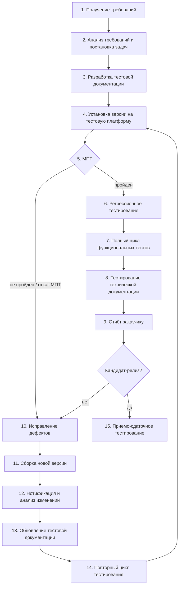
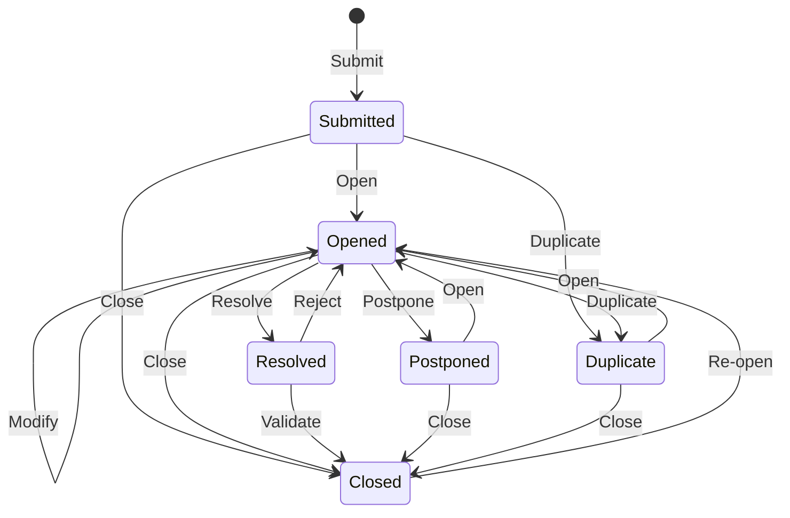
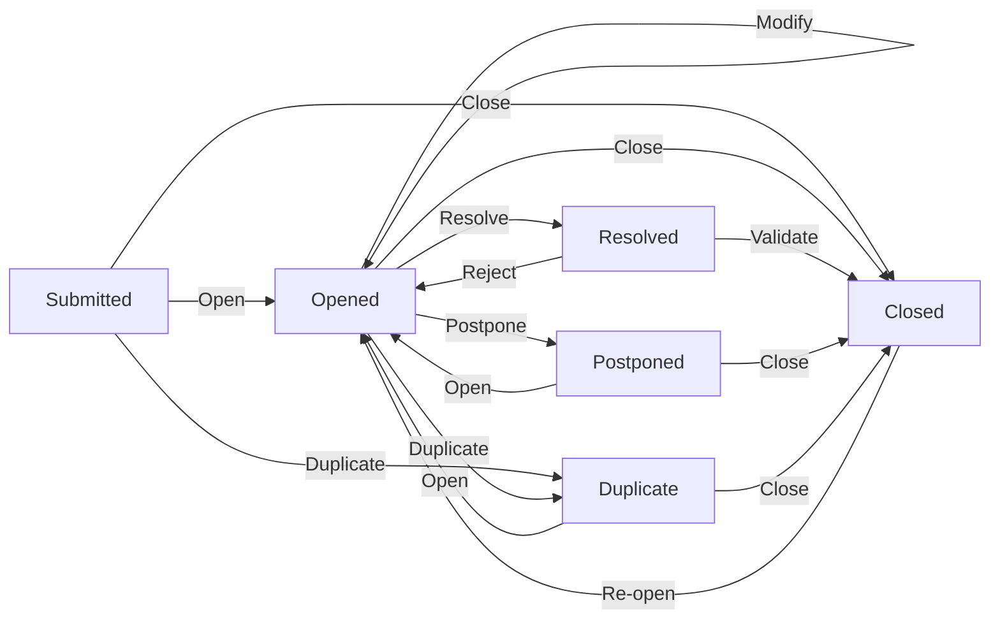

# ПЛАН ТЕСТИРОВАНИЯ  
## BookSphere

| Параметр | Значение |
|---|---|
| Product version | v 1.0.0 |
| Предоставлено для | <Заказчик> |
| Предоставил | <Компания-исполнитель> |
| Дата | 28 октября 2026 г. |
| Версия документа | V 1.0.0 |
| Исполнитель | <Исполнитель> |

### История изменений

| Версия | Дата | Автор | Описание изменений |
|---|---|---|---|
| V 1.0.0 | 28.10.2026 | Руководитель группы тестирования | Первоначальная версия плана тестирования BookSphere |

---

## 1 СПИСОК СОКРАЩЕНИЙ И АББРЕВИАТУР

| Сокращение / аббревиатура | Описание |
|---|---|
| Заказчик | Организация, в интересах которой разрабатывается BookSphere, имеющая полномочия утверждать требования и принимать результат. |
| Дефект | Несоответствие требованиям к BookSphere. |
| План тестирования | Документ, описывающий объём, методы и задачи тестирования. |
| Продукт | BookSphere — e-commerce платформа продажи печатных, электронных и аудиокниг. |
| Проект | Ограниченная во времени деятельность по разработке и внедрению BookSphere. |
| Тестовый сценарий | Документ с перечнем проверок для группы функционала без детальной спецификации тестовых данных. |
| Тестовый случай | Документ с детальным описанием теста, данными и ожидаемым результатом. |
| Набор тестовых данных | Документ с пререквизитами для функционального и автоматизированного тестирования. |
| МПТ | Минимальный приемочный тест, Smoke Test. |
| API | Application Programming Interface. |
| DRM | Digital Rights Management, защита электронных книг. |
| CMS | Content Management System. |
| PIM | Product Information Management. |
| OMS | Order Management System. |
| BI | Business Intelligence. |
| SLA | Service Level Agreement. |
| PCI DSS | Стандарт безопасности данных платёжных карт. |
| 152-ФЗ / GDPR | Требования к защите персональных данных. |
| LTS | Long-Term Support, долгосрочная поддержка версии ПО. |
| p95 / p99 | 95-й / 99-й процентиль времени отклика. |
| Jira | Дефект-трекинговая система проекта. |

---

## 2 ВВЕДЕНИЕ

### 2.1 Содержание документа

Документ описывает процесс тестирования, стратегию, подходы, ресурсы, методологию, управление дефектами, график и отчётность по проекту BookSphere. Документ определяет взаимодействие группы тестирования с командой разработки и заказчиком.

### 2.2 Цель документа

- Спланировать управление тестированием и техническую поддержку тестирования BookSphere.
- Обеспечить полноту проверок в соответствии с требованиями паспорта продукта.
- Определить методы регистрации дефектов, инструменты, отчётность и критерии качества.
- Определить график работ, ресурсы, стратегию и методологию тестирования.
- Определить критерии качества и условия допуска версий к тестированию и поставке.

### 2.3 Целевая аудитория

Документ предназначен для группы тестирования BookSphere, команды разработки, DevOps, инженеров по ИБ и представителей заказчика. Он используется для понимания целей, объёма, процессов и критериев качества.

### 2.4 Ссылки на проектную документацию

План тестирования основан и имеет ссылки на следующую проектную документацию:

1. BookSphere_Project_Plan.mpp — план временных затрат, сроки и даты доставки промежуточных результатов.
2. BookSphere_ТЗ.doc — техническое задание.
3. BookSphere_Руководство_пользователя.doc — руководство пользователя.
4. BookSphere_Техническое_тестирование.doc — сценарии технического тестирования.
5. BookSphere_Журнал_тестирования.xlsx — журнал тестирования.
6. BookSphere_Сценарии_тестирования.xlsx — сценарии тестирования.

### 2.5 Обзор программного продукта

BookSphere — масштабируемая e-commerce платформа нового поколения для продажи печатных книг, электронных книг и аудиокниг. Продукт построен по архитектуре Headless Commerce и поддерживает каналы Web, Mobile App, Smart TV и голосовые ассистенты. Платформа включает витрину, checkout, back-office, DRM, Headless CMS, Telegram-бот, модерацию отзывов, AI-рекомендации, бизнес-модели прямых продаж, подписки, маркетплейса и B2B-лицензий, а также USP: книжные клубы, голосовые рецензии, AR-витрину, эко-трекинг и гибридный ридер.

### 2.6 Цели тестирования

- Выявление несоответствий требованиям к BookSphere.
- Отслеживание статусов дефектов и контроль их исправления.
- Предоставление суммарной оценки качества продукта.
- Снижение рисков проекта, связанных с качеством, интеграциями, нагрузкой, безопасностью и DRM.
- Подтверждение готовности кандидат-релиза к приемо-сдаточному тестированию.

---

## 3 ОБЪЁМ ТЕСТИРОВАНИЯ

### 3.1 Перечень тестируемых компонентов

| Наименование приложения/компонента | Группа функций (модуль) | Функции | Ссылки | Риск | Обоснование |
|---|---|---|---|---|---|
| BookSphere Web | Канал Web | Витрина, каталог, поиск, карточка товара, личный кабинет, AI-рекомендации; Next.js с SSR/SSG | 1; 3.1; 4 | Высокий | Основной канал продаж и SEO; ошибки влияют на конверсию и доступность. |
| BookSphere Mobile | Канал Mobile | Flutter-приложение; нативный аудиоплеер; оффлайн-режим e-books; синхронизация прогресса чтения/прослушивания | 3.1; 4; 8 | Высокий | Мобильный канал критичен для продаж и потребления цифрового контента. |
| BookSphere Smart TV | Канал Smart TV | Доступ к витрине и библиотеке через Smart TV | 1; 4 | Средний | Дополнительный канал; влияет на охват, но не блокирует основные продажи. |
| BookSphere голосовые ассистенты | Канал голосовых ассистентов | Интеграция канала с витриной и каталогом | 1; 4 | Средний | Дополнительный канал; зависит от внешних платформ. |
| Витрина | Умный каталог и поиск | Поиск с опечатками, синонимами, морфологией; фильтры по жанрам, авторам, издательствам, году, рейтингу, цене, формату | 3.1 | Высокий | Каталог и поиск — точка входа в продажи; сбои снижают конверсию. |
| Витрина | Карточка товара | Форматы покупки, Look Inside с защитой от копирования, видеообзоры, инфографика, похожие книги, отзывы с фото/видео | 3.1 | Высокий | Влияет на выбор и доверие; защита фрагмента связана с DRM. |
| Витрина | Личный кабинет | История заказов, статусы доставки, «Моя библиотека», синхронизация прогресса, лояльность, Wishlist и совместные вишлисты | 3.1 | Высокий | Хранит персональные данные и цифровой контент; ошибки критичны для пользователя. |
| Витрина | AI-рекомендации | Персональная лента «Для вас», коллаборативная фильтрация | 3.1 | Средний | Влияет на дополнительную выручку, но не блокирует покупку. |
| Checkout | Оформление заказа | Гостевой checkout, расчёт доставки, промокоды, сертификаты, бонусы, выбор оплаты | 3.2 | Высокий | Прямо влияет на выручку, платёжные интеграции и юридические требования. |
| Back-office | PIM | Массовый импорт/экспорт CSV, XML, API; управление атрибутами, авторами, сериями | 3.3 | Высокий | Ошибки ведут к неверным карточкам товаров и каталогу. |
| Back-office | OMS | Воркфлоу статусов, распределение заказов по складам, печать накладных и штрихкодов | 3.3 | Высокий | Ошибки ведут к неверным заказам, остаткам и доставке. |
| Back-office | Маркетинг и контент | Конструктор лендингов, баннеры, рассылки, блог/журнал о книгах | 3.3 | Средний | Влияет на маркетинг и контент, реже блокирует продажи. |
| Back-office | Аналитика и BI | Дашборды LTV, CAC, конверсия, ABC-анализ, прогнозирование спроса | 3.3 | Высокий | Ошибки ведут к неверным управленческим решениям. |
| DRM | Защита электронных книг | Шифрование файлов, защита от нелегального копирования, выдача DRM-защищённых файлов | 4; 5, п. 6 | Высокий | Нарушение DRM — риск утечки контента и юридических претензий. |
| Headless CMS | Управление контентом | Strapi или Sanity; управление контентом маркетологами, лендинги, баннеры, блог | 3.3; 4 | Средний | Ошибки влияют на контент и маркетинг, но реже блокируют продажи. |
| Telegram-бот | Коммуникации и ассистент | Бот-ассистент, уведомления | 5, п. 5 | Средний | Влияет на коммуникации и поддержку; есть альтернативные каналы. |
| Модерация отзывов | Отзывы и UGC | Модерация отзывов с фото и видео | 3.1 | Средний | Влияет на доверие и репутацию; требует защиты от недопустимого контента. |
| Бизнес-модели | Монетизация | Прямые продажи, подписка, маркетплейс, B2B-лицензии | 7 | Высокий | Ошибки в подписке, комиссиях и B2B-доступах напрямую влияют на доход. |
| USP | Уникальные преимущества | Книжные клубы, голосовые рецензии, публичные полки, AR-витрина, эко-трекинг, Immersion Reading | 8 | Средний | Дифференциаторы важны для удержания, но не все блокируют базовую продажу. |
| Внешние интеграции | Платежи, логистика, ERP, CRM, коммуникации, поставщики контента | ЮKassa, CloudPayments, Stripe; Shiptor, GotoRoute; 1С, МойСклад; Bitrix24/amoCRM; SendGrid, Twilio/SMS.ru, Telegram Bot API; API издательств и агрегаторов | 5, пп. 1–6 | Высокий | Отказ интеграции может остановить оплату, доставку и поставку контента. |
| API Gateway и микросервисы | Архитектура и API | Kong или AWS API Gateway; каталог/поиск, корзина/заказы, пользователи/аутентификация, AI/рекомендации | 4 | Высокий | Отказ микросервиса или Gateway влияет на все каналы и бизнес-процессы. |
| Инфраструктура и мониторинг | DevOps и эксплуатация | Kubernetes, CI/CD, Prometheus, Grafana, ELK Stack, Sentry, Auto-scaling | 4; 6 | Высокий | Ошибки инфраструктуры влияют на доступность, SLA и восстановление. |
| Безопасность и соответствие | ИБ и комплаенс | PCI DSS, 152-ФЗ/GDPR, защита от DDoS и SQL-инъекций, разграничение доступа | 6 | Высокий | Нарушения ведут к юридическим, финансовым и репутационным рискам. |

Тестированию на первой итерации подлежат все функции системы как изолировано — тестирование работы функций системы внутри модулей, так и в целом — тестирование взаимодействия модулей системы, выполнение бизнес-процессов в системе, проверка полных циклов жизни документов.

Тестирование инсталляции и работы системы в различных конфигурациях. В процессе проведения работ по тестированию на второй итерации предполагается проведение регрессионного тестирования — проверка исправления дефектов, зарегистрированных на первой итерации, тест новой функциональности, выполнение бизнес-процессов в системе, проверка полных циклов жизни документов.

### 3.2 Нетестируемые компоненты

| Компонент | Причина нетестируемости | Что тестируется |
|---|---|---|
| Внутренние процессы платёжных шлюзов ЮKassa, CloudPayments, Stripe | Внешние сервисы, недоступны для изменения и внутреннего тестирования | Точки интеграции: создание платежа, callback, статусы, ошибки, таймауты, идемпотентность, sandbox-сценарии |
| Внутренняя логика API служб доставки и агрегаторов | Внешние системы | Контракты API, расчёт сроков/стоимости, трекинг, обработка ошибок и недоступности |
| Внутренняя логика 1С, МойСклад, Bitrix24/amoCRM | Корпоративные системы заказчика/третьих лиц | Обмен остатками, ценами, лидами, историями покупок; форматы, retry, ошибки |
| Внутренняя реализация DRM-провайдеров и поставщиков контента | Внешние защищённые сервисы | Точки интеграции: получение метаданных, DRM-файлов, проверка лицензий, ошибки |
| Обучение и качество AI-моделей как таковых | Модели обучаются вне тестового контура | Интеграция рекомендаций, fallback, отсутствие рекомендаций, релевантность по метрикам |
| Аппаратные платформы Smart TV и голосовые ассистенты | Зависит от вендоров и устройств | Интеграционные сценарии, API-контракты, деградация при недоступности |
| Облачная инфраструктура Yandex Cloud/AWS и Kubernetes | Внешняя инфраструктура | Конфигурация, автоскейлинг, мониторинг, отказоустойчивость на уровне интеграции |

---

## 4 ТРЕБУЕМЫЕ РЕСУРСЫ

### 4.1 Проектная команда

| Роль | Имя и фамилия | Место нахождения | Ответственность |
|---|---|---|---|
| Руководитель группы тестирования (x1) | <ФИО> | <город> | Контактное лицо по проектным вопросам; планирование тестирования; тестовая документация; управление дефектами; отчётность. |
| Функциональный тестировщик (xN) | <ФИО> | <город> | Функциональное тестирование, сценарии, тест-кейсы, регрессия, валидация дефектов. |
| Технический тестировщик (xN) | <ФИО> | <город> | Нагрузочное и стресс-тестирование, производительность, узкие места, автоматизация. |
| Инженер по ИБ (xN) | <ФИО> | <город> | Проверки PCI DSS, 152-ФЗ/GDPR, DRM, уязвимости, доступы, аудит безопасности. |
| DevOps-инженер (xN) | <ФИО> | <город> | Среды dev/test/staging, CI/CD, мониторинг, конфигурация, изоляция данных. |
| Представитель заказчика (xN) | <ФИО> | <город> | Приёмка требований, UAT, согласование критериев, приёмка результатов. |
| Менеджер проекта заказчика (xN) | <ФИО> | <город> | Проектные вопросы со стороны заказчика, контроль сроков и приёмки. |
| Системный аналитик заказчика (xN) | <ФИО> | <город> | Вопросы корректности функционирования системы со стороны заказчика. |
| Лидер команды разработчиков (xN) | <ФИО> | <город> | Квалификация дефектов, назначение ответственных, исправления, сборки. |
| Разработчик функции (xN) | <ФИО> | <город> | Исправление дефектов, указание версии сборки с фиксом, уточнение реализации. |

### 4.2 Тестовая конфигурация

Версии ПО — актуальная LTS на момент развертывания. Конкретные номера версий фиксируются в акте развертывания среды.

| Роль | Аппаратное обеспечение | Программное обеспечение |
|---|---|---|
| dev — разработка и первичная проверка | Допущение: 4 vCPU, 16 ГБ RAM, 100 ГБ SSD на узел; Kubernetes-кластер из 3 узлов | Актуальная LTS на момент развертывания: Kubernetes, PostgreSQL, Redis, MongoDB, S3-совместимое хранилище, Elasticsearch, Keycloak, Kong, Headless CMS; GitLab CI/GitHub Actions; k6/JMeter, Playwright, Appium, OWASP ZAP |
| test — функциональное, регрессионное, интеграционное тестирование | Допущение: 8 vCPU, 32 ГБ RAM, 200 ГБ SSD на узел; Kubernetes-кластер из 3–5 узлов | Актуальная LTS на момент развертывания: те же сервисы в конфигурации, близкой к staging; GitLab CI/GitHub Actions; k6/JMeter, Playwright, Appium, OWASP ZAP; Prometheus, Grafana, ELK Stack, Sentry |
| staging — предрелизное, нагрузочное, приёмочное тестирование | Допущение: 16 vCPU, 64 ГБ RAM, 500 ГБ SSD на узел; Kubernetes-кластер из 5–7 узлов; конфигурация, близкая к production | Актуальная LTS на момент развертывания: те же сервисы; GitLab CI/GitHub Actions; k6/JMeter, Playwright, Appium, OWASP ZAP; Prometheus, Grafana, ELK Stack, Sentry |

Схема окружений: dev → test → staging. Переход между средами выполняется через CI/CD GitLab CI/GitHub Actions. Данные production не копируются в dev/test/staging без маскирования. Доступы разделены по ролям; секреты хранятся вне репозиториев.

---

## 5 СТРАТЕГИЯ ТЕСТИРОВАНИЯ

Основной метод — ручное функциональное тестирование «чёрным ящиком» на основе требований и спецификаций, дополняется автоматизированным и техническим тестированием.

### 5.1 Функциональное тестирование

Функциональное тестирование проверяет соответствие BookSphere требованиям и корректность реализации функций. Выполняется функциональным тестировщиком.

#### 5.1.1 Минимальный приёмочный тест (Smoke Test)

МПТ — короткий тест основной функциональности, длительностью не более 1 часа. По результатам принимается решение о допуске версии к дальнейшему тестированию. МПТ выполняется для каждой поставленной версии. При отказе версия возвращается на исправление критических дефектов.

#### 5.1.2 Регрессионное тестирование

Регрессионное тестирование проверяет исправление дефектов, отсутствие новых дефектов и совместимость новой функциональности с ранее протестированной. Выполняется повторное прохождение тестовых случаев после завершения предыдущего этапа.

#### 5.1.3 Функциональный тест

Функциональный тест проверяет основную и нестандартную функциональность: граничные значения, специальные символы, бизнес-процессы, логические цепочки, взаимодействие функций, обновление и отображение данных, завершение операций. Используется весь объём тестовой документации.

### 5.2 Автоматизированное тестирование

Автоматизация входит в объём тестирования BookSphere. Автоматизируются регрессионные, интеграционные, API- и smoke-проверки, а также подготовка тестовых данных. Автоматизация выполняется техническим тестировщиком совместно с функциональной командой. Результаты автоматизации включаются в журнал и отчётность.

### 5.3 Техническое тестирование

Техническое тестирование проверяет нефункциональные требования: нагрузку, производительность, устойчивость, восстановление, большие объёмы данных, узкие места, безопасность и соответствие.

| Параметр | Значение |
|---|---|
| Профиль нагрузки | Ramp-up 15 мин → плато 60 мин → спад 15 мин; всего 90 мин |
| Пиковая нагрузка | До 10 000 одновременных пользователей |
| Распределение операций | Каталог/поиск — 35%; карточка товара — 20%; корзина/checkout — 15%; авторизация/личный кабинет/библиотека — 10%; AI-рекомендации — 10%; отзывы/модерация — 5%; back-office/API — 5% |
| Требование task.md | Время ответа API < 200 мс |
| Допущение: p95 внутреннего API | < 200 мс |
| Допущение: p99 внутреннего API | < 500 мс |
| Допущение: p95 checkout | < 2 с |
| Допущение: p95 внешних платежей | < 3 с |
| Допущение: допустимый процент ошибок | ≤ 1% всех запросов; ≤ 0,1% для критических операций |
| SLA из task.md | 99,9%; не более 8 часов простоя в год на плановые работы |
| Масштабируемость из task.md | Автоматическое горизонтальное масштабирование (Auto-scaling) микросервисов |
| Допущение: стресс-профиль | До 15 000 одновременных пользователей с проверкой восстановления после сбоев |
| Тесты больших объёмов данных | Проверка работы с крупной БД, каталогом, заказами и медиаданными |
| Восстановление после сбоев | Проверка восстановления сервисов, БД, очередей и сессий |
| Безопасность и соответствие | PCI DSS, 152-ФЗ/GDPR, защита от DDoS и SQL-инъекций |

Отдельно фиксируется: требование «API < 200 мс» взято из task.md; пороги checkout и внешних платежей являются допущением.

---

## 6 МЕТОДОЛОГИЯ ТЕСТИРОВАНИЯ

### 6.1 Обзор процесса

**Рис. 1. Процесс тестирования BookSphere**

1. Получение требований к программному продукту (предоставляется заказчиком).
2. Анализ требований, определение целей и постановка задач по тестированию (определяется в данном документе).
3. Разработка проектной документации:
   - план тестирования: определение тестовой стратегии; выявление необходимых ресурсов; определение тестовой конфигурации; расчёт трудоёмкости; составление предварительного графика тестирования;
   - написание Test Cases, разработка тестовых сценариев и наборов тестовых данных для технического тестирования и автоматизации функционального тестирования.
4. Установка очередной версии продукта на тестовую платформу.
5. Проведение МПТ и принятие решения о приемке версии для тестирования или отказе.
6. Регрессионное тестирование — проверка и валидация исправленных дефектов.
7. Проведение полного цикла функциональных тестов; регистрация дефектов.
8. Проведение тестирования технической документации (руководства пользователей).
9. Предоставление отчёта заказчику о качестве программного продукта с перечнем выявленных дефектов.
10. Исправление дефектов (осуществляется командой разработчиков/заказчиком).
11. Сборка новой версии программного продукта (осуществляется командой интеграторов на стороне заказчика).
12. Получение группой тестирования нотификации об изменениях в новой версии продукта, анализ новой функциональности.
13. Внесение изменений в тестовую документацию в связи с имплементацией новой функциональности или изменениями требований.
14. Повторный цикл тестирования (пункт 4).
15. При выпуске кандидат-релиза — выполнение полного приемо-сдаточного тестирования.

### 6.2 Тестовая документация

Для обеспечения процесса тестирования требуется разработка следующей проектной тестовой документации:

1. План тестирования (данный документ), документ в формате Word.
2. Сценарии тестирования BookSphere — документ в формате Excel/Word.
3. Техническое тестирование — сценарий проведения технического тестирования, документ в формате Word.
4. Журнал тестирования — документ в формате Excel.

В 2.4 дополнительно приведены проектные документы (ТЗ и руководство пользователя), не входящие в перечень тестовой документации.

Дополнительная документация разрабатывается по согласованию с заказчиком.

### 6.3 Доставка новых версий программного продукта

#### 6.3.1 Процесс доставки

Новые версии размещаются заказчиком на FTP-сервере или передаются иным согласованным способом. Каждая версия сопровождается e-mail-нотификацией с номером версии и перечнем изменений. К началу повторного цикла разработчики приводят дефекты в Jira в актуальное состояние: исправленные дефекты переводятся на валидацию, владельцами становятся тестировщики, зарегистрировавшие дефекты.

#### 6.3.2 Критерии приёмки на тестирование

Тестирование версии может быть отложено полностью или частично, если:

- в версии нет изменений;
- дефекты блокируют большую часть функциональности;
- версия недоступна для тестирования.

### 6.4 Управление дефектами

Для регистрации и отслеживания дефектов используется Jira. Выбор обоснован необходимостью прозрачного контроля статусов, истории изменений, разграничения ролей, интеграции с CI/CD и отчётности. Jira обеспечивает доступ заинтересованных сторон и снижает необходимость отдельных отчётов.

#### 6.4.1 Определение степени важности дефектов

Важность дефекта (Severity) нужна для оценки влияния на корректность работы BookSphere.

| Важность | Описание |
|---|---|
| Критический | Блокирует большую часть функциональности, полностью нерабочая функция или ветвь, приводит к потере информации. |
| Серьезный | Приводит к некорректной работе части функциональности, недоступности опций, блокирует отдельную функцию, но не всю систему. |
| Средний | Неправильно работает неосновная часть функциональности, есть обходной путь, тестирование не блокируется. |
| Незначительный | Приложение работает, бизнес-логика не нарушена, исправление откладывается на последнюю очередь. |

**Допущение: SLA реакции и исправления по важности**

| Важность | Время реакции | Время исправления |
|---|---:|---:|
| Критический | 15 минут | 8 часов |
| Серьезный | 1 час | 2 рабочих дня |
| Средний | 4 часа | 5 рабочих дней |
| Незначительный | 8 часов | следующий релиз |

#### 6.4.2 Определение приоритета дефектов

Приоритет определяется на основе серьезности дефекта и критичности функции для пользователя.

- «Исправить незамедлительно» — наивысший приоритет, исправление в кратчайшие сроки.
- «Уделить повышенное внимание» — срочное исправление не требуется, но устранение необходимо в ближайшее время.
- «Обычный» — приоритет по умолчанию при регистрации.
- «Низкий» — исправление после всех других ошибок.
- «Улучшение» — предложение тестовой группы, внедряется после валидации заказчиком.

#### 6.4.3 Цикл жизни дефекта

**Рис. 2. Цикл жизни дефекта**

#### 6.4.4 Матрица переходов

Матрица читается так: строка — текущее состояние дефекта, столбец — целевое состояние, ячейка — действие. Пустая ячейка означает отсутствие разрешённого перехода. Дублирование допускается из состояний Submitted и Opened. Переход Opened → Closed выполняется действием Close лидером команды разработчиков; ответственное лицо — руководитель группы тестирования; указывается резолюция о причине закрытия.

| Из \ В | Submitted | Opened | Resolved | Closed | Duplicate | Postponed |
|---|---|---|---|---|---|---|
| Submitted | — | Open | — | Close | Duplicate | — |
| Opened | — | Modify | Resolve | Close | Duplicate | Postpone |
| Resolved | — | Reject | — | Validate | — | — |
| Closed | — | Re-open | — | — | — | — |
| Duplicate | — | Open | — | Close | — | — |
| Postponed | — | Open | — | Close | — | — |

**Рис. 3. Матрица переходов дефекта в виде графа**

| № | Предыдущее состояние | Действие | Новое состояние | Кто произвёл | Ответственное лицо | Комментарии |
|---:|---|---|---|---|---|---|
| 1 | Нет | Submit | Submitted | Тестировщик / руководитель группы тестирования | Руководитель группы тестирования | Заполняются обязательные атрибуты |
| 2 | Submitted | Open | Opened | Руководитель группы тестирования | Лидер команды разработчиков | Передача дефекта разработке |
| 3 | Submitted | Close | Closed | Руководитель группы тестирования | Руководитель группы тестирования | Резолюция о причине закрытия |
| 4 | Submitted | Duplicate | Duplicate | Руководитель группы тестирования | Руководитель группы тестирования | Указывается номер дублирующего дефекта |
| 5 | Opened | Modify | Opened | Лидер команды разработчиков | Разработчик функции | Назначается ответственный за исправление; статус не меняется |
| 6 | Opened | Postpone | Postponed | Лидер команды разработчиков | Лидер команды разработчиков | Причина откладывания |
| 7 | Opened | Resolve | Resolved | Разработчик функции | Тестировщик, осуществивший регистрацию | Указывается версия сборки с фиксом |
| 8 | Opened | Close | Closed | Лидер команды разработчиков | Руководитель группы тестирования | Резолюция о причине закрытия |
| 9 | Opened | Duplicate | Duplicate | Руководитель группы тестирования | Руководитель группы тестирования | Указывается номер дублирующего дефекта |
| 10 | Postponed | Open | Opened | Лидер команды разработчиков | Лидер команды разработчиков | Дефект снова принят в работу |
| 11 | Postponed | Close | Closed | Лидер команды разработчиков | Лидер команды разработчиков | Резолюция о причине закрытия |
| 12 | Resolved | Validate | Closed | Тестировщик | Тестировщик | Дефект исправлен и закрыт |
| 13 | Resolved | Reject | Opened | Тестировщик | Разработчик функции | Указываются причины отказа в валидации |
| 14 | Closed | Re-open | Opened | Руководитель группы тестирования | Лидер команды разработчиков | Дефект проявился повторно |
| 15 | Duplicate | Open | Opened | Руководитель группы тестирования | Лидер команды разработчиков | Дефект ошибочно переведён в дубликат |
| 16 | Duplicate | Close | Closed | Руководитель группы тестирования | Руководитель группы тестирования | Дефект подтверждён как дубликат и закрыт |

В качестве резолюции о причине закрытия дефекта из состояний «зарегистрирован», «открыт», «отложен» могут быть рассмотрены следующие варианты:

- Разработано согласно требованиям (дефект открыт ошибочно).
- Дефект несущественный и не требует исправления (не нарушены бизнес-требования).
- Коррекция дефекта нецелесообразна — исправление дефекта окажет критическое действие на большую часть функциональности (предложение варианта по изменению требований к продукту).

**Соответствие статусов Jira (только исходящие переходы)**

| Jira-статус | Действие | Целевой Jira-статус |
|---|---|---|
| Зарегистрирован (Submitted) | Open | Открыт (Opened) |
| Зарегистрирован (Submitted) | Close | Закрыт (Closed) |
| Зарегистрирован (Submitted) | Duplicate | Дубликат (Duplicate) |
| Открыт (Opened) | Modify | Открыт (Opened) |
| Открыт (Opened) | Postpone | Отложен (Postponed) |
| Открыт (Opened) | Resolve | Исправлен (Resolved) |
| Открыт (Opened) | Close | Закрыт (Closed) |
| Открыт (Opened) | Duplicate | Дубликат (Duplicate) |
| Исправлен (Resolved) | Validate | Закрыт (Closed) |
| Исправлен (Resolved) | Reject | Открыт (Opened) |
| Закрыт (Closed) | Re-open | Открыт (Opened) |
| Дубликат (Duplicate) | Open | Открыт (Opened) |
| Дубликат (Duplicate) | Close | Закрыт (Closed) |
| Отложен (Postponed) | Open | Открыт (Opened) |
| Отложен (Postponed) | Close | Закрыт (Closed) |

#### 6.4.5 Процесс взаимодействия команд тестирования и разработки ПО при работе с дефект-трекинговой системой

При регистрации дефект получает статус Submitted, owner — руководитель группы тестирования. Руководитель группы тестирования проверяет воспроизведение и открывает дефект на лидера команды разработчиков — статус Opened. Лидер команды разработчиков квалифицирует дефект и выполняет Modify: редактируется только поле Owner, как правило, назначается разработчик функции; статус остаётся Opened. Jira автоматически уведомляет разработчика функции.

После исправления разработчик функции указывает версию сборки с фиксом, выполняет Resolve, owner = тестировщик, осуществивший регистрацию; дефект переходит в Resolved. Тестировщик проверяет исправление: при успехе выполняет Validate → Closed; при неуспехе — Reject → Opened, owner = разработчик функции, указываются причины и версия проверки. Цикл повторяется.

На промежуточных этапах доступен Modify — изменение полей и комментариев без смены статуса. Лидер команды разработчиков может закрывать дефект через Close с резолюцией; при закрытии из Opened ответственным лицом становится руководитель группы тестирования. Исправление может быть отложено через Postpone → Postponed. Если дефект дублирует ранее зарегистрированный, используется Duplicate из Submitted или Opened с указанием номера дублирующего дефекта. Если дефект не воспроизводится или описан недостаточно подробно, owner переводится на тестировщика, который дополняет описание в Jira и уведомляет разработчика.

Лидеры команд имеют право на удаление дефектов из системы (action = Delete) — не рекомендуется, так как информация по дефекту и его история полностью утрачиваются.

#### 6.4.6 Регистрация дефектов

| Название поля | Описание | Поле Jira |
|---|---|---|
| ID | Идентификационный номер, заполняется автоматически | ID |
| Статус | Текущее состояние дефекта | Status |
| Заголовок | Краткое описание с привязкой к функции | Summary |
| Ответственное лицо | Член команды, принимающий решение и ведущий дефект | Assignee |
| Важность | Критический, Серьезный, Средний, Незначительный | Severity |
| Приоритет | Срочность исправления | Priority |
| Модуль | Модуль обнаружения | Module |
| Группа | Группа функций | Group |
| Функция | Функция с дефектом | Function |
| Версия тестируемого ПО | Номер версии продукта | Build № |
| Компонент исправления | Компонент/сборка для проверки фикса | Fixed In |
| Описание | Полное описание, шаги воспроизведения, влияние | Description |
| Новая заметка | Дополнительные сведения | Comment |
| История заметок | История комментариев | Comment history |
| История изменений | Все действия, кто и когда выполнял | History |
| Резолюция | Причина закрытия | Resolution |
| Присоединённые файлы | Скриншоты, логи, видео | Attachments |

#### 6.4.7 Критерии качества продукта

- Продукт работает в соответствии со спецификациями и требованиями.
- Функциональность покрывает требования, запланированные на итерацию/релиз.
- Выполнение плана: 100% МПТ; ≥ 95% регрессионных тестов; ≥ 98% функциональных тест-кейсов, запланированных на релиз.
- Покрытие требований: ≥ 95% требований task.md; 100% критических бизнес-процессов.
- Открытые дефекты к поставке: 0 «Критический»; 0 «Серьезный»; «Средний» — не более 5 с согласованным обходным путём; «Незначительный» — по решению заказчика.
- Нагрузка: p95 внутреннего API < 200 мс; p95 checkout < 2 с; p95 внешних платежей < 3 с; ошибки ≤ 1% всех запросов и ≤ 0,1% критических операций; поддержка 10 000 одновременных пользователей.
- SLA: доступность 99,9%; не более 8 часов простоя в год на плановые работы.
- Масштабируемость: Auto-scaling микросервисов подтверждён при росте нагрузки.
- Допущение: стресс-профиль до 15 000 одновременных пользователей с успешным восстановлением после сбоев.
- Тесты больших объёмов данных: успешная работа с крупной БД, каталогом, заказами и медиаданными.
- Восстановление после сбоев: успешное восстановление сервисов, БД, очередей и сессий.
- Безопасность: соответствие PCI DSS, 152-ФЗ/GDPR; отсутствие критических уязвимостей по результатам проверок DDoS и SQL-инъекций.

#### 6.4.8 Правила наименования пользователей системы Jira

Краткое имя пользователя в Jira формируется по схеме: 1-я буква имени + 2-е первые буквы фамилии. Пример: для пользователя Natallia Hustyr краткое имя в системе — NHU. Правило едино для всех пользователей Jira.

#### 6.4.9 Правила ведения переписки

Контактные лица со стороны заказчика: менеджер проекта — по проектным вопросам, системный аналитик — по функционированию системы, лидер команды разработчиков — по дефектам. Со стороны группы тестирования: руководитель группы тестирования — по проектным вопросам, тестировщик, зарегистрировавший дефект, — по дефектам.

Письмо должно содержать «Заголовок», однозначно определяющий тему, и тело с запросом. В копию включаются заинтересованные лица. Ответ направляется не позднее 4 часов с момента получения. Если корректный ответ невозможен, отправитель уведомляет о получении и указывает предполагаемую дату развёрнутого ответа. При отсутствии ответа письмо дублируется с копией менеджера проекта.

---

## 7 ГРАФИК ТЕСТИРОВАНИЯ

### 7.1 Ссылка на проектный план

| Этап | Длительность |
|---|---|
| Discovery & Аналитика | 1–2 месяца; Допущение: 6 недель |
| Проектирование и Дизайн | 2 месяца; Допущение: 8 недель |
| Разработка MVP | 3–4 месяца; Допущение: 14 недель |
| Разработка Full-версии | 3–4 месяца; Допущение: 14 недель |
| QA и нагрузочное тестирование | 1 месяц; Допущение: 4 недели |
| Релиз и поддержка | Soft Launch — Допущение: 4 недели, далее Agile/Scrum |

Допущение: длительность до релиза — 46 недель; Soft Launch — 4 недели. Подробные временные затраты — в BookSphere_Project_Plan.mpp.

### 7.2 Общая оценка временных затрат

**Допущение: оценки трудозатрат приведены в человеко-днях и уточняются в проектном плане.**

| Этап | РТ | ФТ | ТТ | ИБ | DevOps | Итого |
|---|---:|---:|---:|---:|---:|---:|
| Discovery & Аналитика (Допущение: 6 нед) | 5 | 3 | 1 | 1 | 0 | 10 |
| Проектирование и Дизайн (Допущение: 8 нед) | 8 | 5 | 2 | 2 | 1 | 18 |
| Разработка MVP (Допущение: 14 нед) | 15 | 25 | 6 | 5 | 8 | 59 |
| Разработка Full-версии (Допущение: 14 нед) | 18 | 30 | 10 | 8 | 10 | 76 |
| QA и нагрузочное тестирование (Допущение: 4 нед) | 12 | 20 | 15 | 6 | 6 | 59 |
| Релиз и поддержка / Soft Launch (Допущение: 4 нед) | 6 | 8 | 4 | 2 | 4 | 24 |
| **Итого** | **64** | **91** | **38** | **24** | **29** | **246** |

Расшифровка столбцов: РТ — руководитель группы тестирования; ФТ — функциональный тестировщик; ТТ — технический тестировщик; ИБ — инженер по ИБ; DevOps — DevOps-инженер.

Проверка сумм: по столбцам 64 + 91 + 38 + 24 + 29 = 246; по строкам 10 + 18 + 59 + 76 + 59 + 24 = 246. Суммы сходятся.

---

## 8 ОЦЕНКА РИСКОВ ПРОЕКТА ТЕСТИРОВАНИЯ

Шкала вероятности и влияния: Низкая / Средняя / Высокая.

| Риск | Вероятность | Влияние | Ответственный | Предварительные меры |
|---|---|---|---|---|
| Изменение функциональных требований на завершающем этапе | Средняя | Высокая | Представитель заказчика | Адаптивная тестовая документация, change control, анализ влияния, приоритизация |
| Критические дефекты при поставке | Средняя | Высокая | Лидер команды разработчиков | Критерии 6.4.7, МПТ, регрессия, блокирующие дефекты |
| Отставание от графика | Средняя | Средняя | Руководитель группы тестирования | Буфер в плане, еженедельный статус, приоритизация тестов |
| Не налажен процесс взаимодействия | Низкая | Средняя | Руководитель группы тестирования | Регламент 6.4.9, Jira, регулярные синки, SLA 4 часа |
| Ошибки у заказчика после тестирования | Низкая | Высокая | Представитель заказчика | Согласование сценариев, UAT, обучение, приёмочные проверки |
| Сложность микросервисов и интеграций | Средняя | Высокая | DevOps-инженер | Контрактные тесты, мониторинг, canary, трассировка |
| DRM и защита контента | Средняя | Высокая | Инженер по ИБ | Интеграционные проверки DRM, ротация ключей, пентест |
| Качество AI-рекомендаций | Средняя | Средняя | Технический тестировщик | Метрики, A/B, fallback, отсутствие рекомендаций |
| Нагрузка 10 000 одновременных пользователей | Средняя | Высокая | Технический тестировщик | Профиль 5.3, автоскейлинг, p95/p99, стресс-тесты |
| PCI DSS, 152-ФЗ, GDPR | Средняя | Высокая | Инженер по ИБ | Аудит, шифрование, доступы, DPIA, проверки |
| Sandbox внешних платежей и доставки | Средняя | Средняя | DevOps-инженер | Sandbox, mocks, контрактные тесты, fallback |
| Поставщики контента и DRM-файлы | Средняя | Средняя | Технический тестировщик | Проверка метаданных, лицензий, ошибок, retry |

---

## 9 ОТЧЁТЫ О РЕЗУЛЬТАТАХ ТЕСТИРОВАНИЯ

Отчёты направляются еженедельно в конце рабочей недели. В отчёт включаются активности команды, статус тестирования, дефекты, риски и артефакты следующей недели.

### 9.1 Журнал тестирования

| Название проекта | Тестируемый модуль | Функция | Тип теста | Тестовый случай | Pass/Fail | Описание |
|---|---|---|---|---|---|---|
| BookSphere | <модуль> | <функция> | GUI / Case | <номер> | <результат> | <дефекты, комментарии> |

Журнал предназначен для высокоуровневого отображения качества продукта. Для каждой новой версии создаются новые колонки Pass/Fail и Описание.

### 9.2 Протокол тестирования

Протокол содержит детальное описание действий тестировщика, полей, опций, типов данных, порядка действий и системных проверок. Формат аналогичен журналу, но с глубокой детализацией. Предназначен для команды тестирования и разработчиков.

### 9.3 Отчёт о зарегистрированных дефектах

| ID | Состояние | Модуль | Название | Описание | Owner | Важность | Приоритет |
|---|---|---|---|---|---|---|---|
| <ID> | <статус> | <модуль> | <краткое описание> | <полное описание> | <владелец> | <важность> | <приоритет> |

Отчёт формируется в Excel и дублирует информацию о дефектах для заказчика и разработчиков.

---

## Отклонения от эталона

- Рисунки 1–3 заменены диаграммами Mermaid с подписями «Рис. 1», «Рис. 2», «Рис. 3».
- В раздел 3.1 добавлены столбцы «Риск» и «Обоснование»; строки детализированы по каналам, модулям back-office, Headless CMS, API Gateway, инфраструктуре и безопасности.
- Трекер Jira выбран и обоснован; добавлены таблица SLA реакции/исправления по важности и таблица соответствия статусов Jira.
- В 6.4.4 добавлены пояснение чтения матрицы, отдельная таблица 16 действий, три варианта резолюции; матрица, диаграмма, граф и таблица действий согласованы.
- В 4.2 добавлена таблица «Роль / Аппаратное обеспечение / Программное обеспечение» для dev/test/staging; аппаратные характеристики помечены как «Допущение», версии ПО указаны как «актуальная LTS на момент развертывания».
- В 5.2 автоматизация включена в объём тестирования.
- В 5.3 добавлены профиль нагрузки, распределение операций, p95/p99, допустимый процент ошибок, SLA, auto-scaling, стресс-профиль, тесты больших объёмов, восстановление и безопасность; пороги checkout, внешних платежей и стресс-профиль помечены как «Допущение».
- В 6.4.7 добавлены измеримые критерии качества, включая SLA, auto-scaling, стресс-профиль, большие объёмы данных, восстановление и безопасность.
- В 7.1 и 7.2 добавлены этапы task.md, длительности и оценка трудозатрат по ролям тестирования, ИБ и DevOps; конкретные недели и Soft Launch помечены как «Допущение», трудозатраты разработчика функции и представителя заказчика исключены.
- В раздел 8 добавлены специфичные риски BookSphere: микросервисы, DRM, AI, нагрузка, PCI DSS/152-ФЗ, sandbox.
- Сокращено/изменено относительно стандарта: вместо графических рисунков используются Mermaid-диаграммы; в 6.2 перечислены только тестовые документы, а проектные документы оставлены в 2.4; в 7.2 трудозатраты ограничены ролями тестирования, ИБ и DevOps; в 3.1 таблица расширена для покрытия специфики BookSphere.